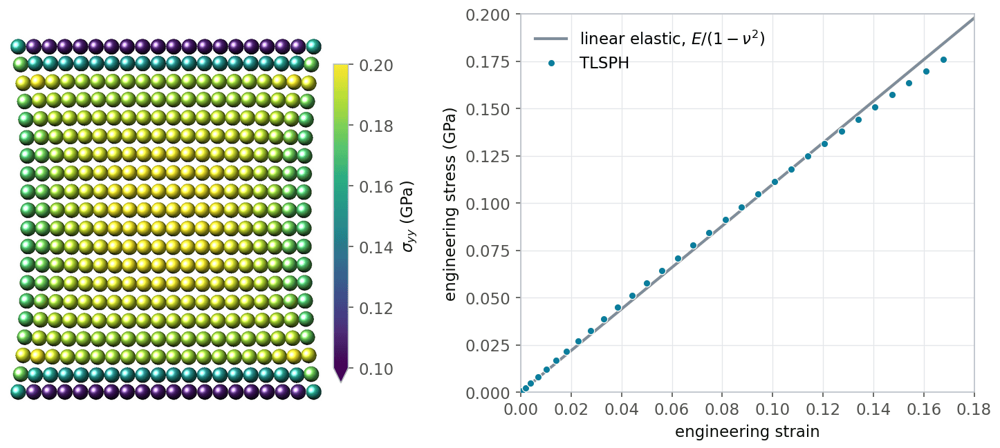
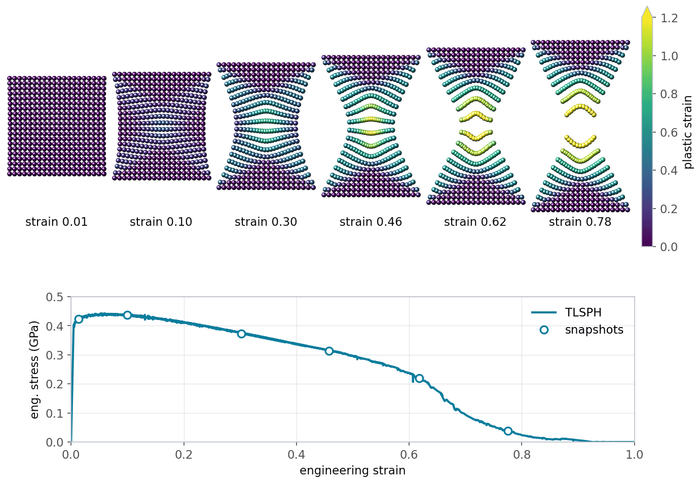
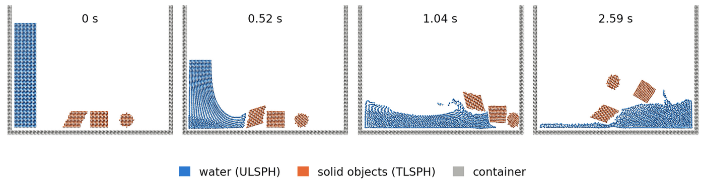
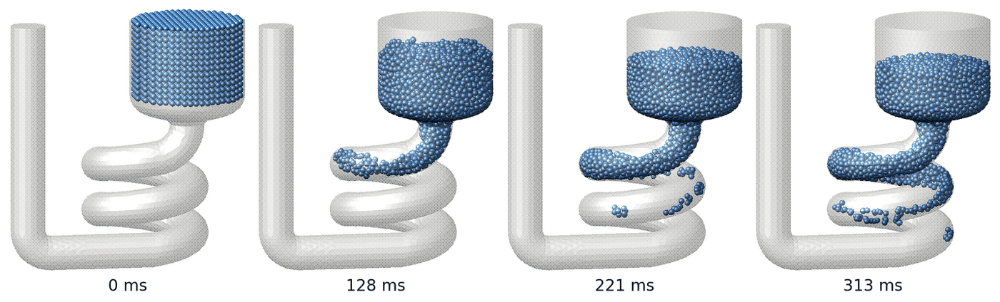
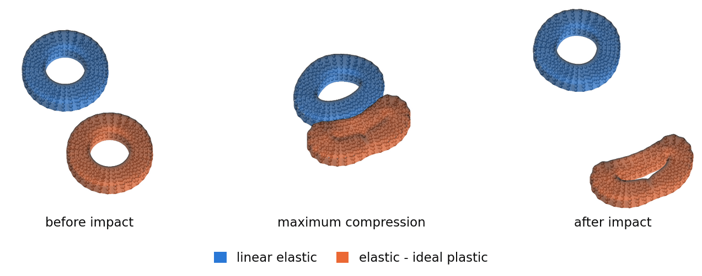

Smoothed Mach dynamics (MACHDYN)
================================

*written by Georg C. Ganzenmueller in 2015; converted from*
``MACHDYN_LAMMPS_userguide.pdf`` *to reStructuredText and updated for
current LAMMPS by Axel Kohlmeyer in 2026*

----

The :ref:`MACHDYN package <PKG-MACHDYN>` implements Smooth Mach Dynamics
(SMD), a meshless method for solving problems in continuum mechanics of
solids and fluids based on :doc:`smoothed particle hydrodynamics (SPH)
<Howto_sph>`.  This Howto gives an introduction to the methods used,
explains how to set up SMD simulations in LAMMPS, describes the
available material models, and discusses the example inputs in the
``examples/PACKAGES/machdyn`` folder.

----

.. contents:: Contents of this Howto:
   :local:
   :depth: 2

----

Overview
""""""""

Smoothed particle hydrodynamics was first developed by Lucy
:ref:`(Lucy) <howto_smd_lucy>` and by Gingold and Monaghan
:ref:`(Gingold) <howto_smd_gingold>` to simulate the formation of
stars.  SPH approximates continuous fields by kernel functions centered
at particles that carry the physical properties of the system, e.g.
mass, internal energy, or velocity.  When applied to fluid flow or the
deformation of solids, the partial differential equations of continuum
mechanics turn into simple algebraic equations for the particles.  As no
computational grid is used, SPH can handle arbitrarily large
deformations and fracture much more easily than mesh-based methods like
the finite element method (FEM), which require well-shaped mesh cells.
Applications include impact, explosions, or machining.

The application of SPH to fluids with free surfaces has been very
successful, but the simulation of solids with SPH is plagued by
numerical instabilities.  The interaction of the kernel function with
tensile stress results in nonphysical clumping of particles, the
so-called tensile instability :ref:`(Swegle) <howto_smd_swegle>`.
Belytschko et al. :ref:`(Belytschko) <howto_smd_belytschko>` showed
that this instability is caused by the combination of an Eulerian kernel
function (particles move in and out of the kernel range of a particle)
with the Lagrangian motion of the particles, and that it is absent in a
*total Lagrangian* formulation, where the kernel functions are evaluated
in the undeformed reference configuration of the material.  A second
source of instability remains: since SPH evaluates the field equations
only at the particle positions, the solution can contain zero-energy
modes of deformation, similar to the hourglass modes of FEM elements with
reduced integration.  The MACHDYN package controls these modes with an
algorithm adapted from FEM :ref:`(Ganzenmueller)
<howto_smd_ganzenmueller>`, which makes the total Lagrangian SPH
formulation stable for large deformations of solids.

The MACHDYN package provides:

- the :doc:`atom style smd <atom_style>`, which stores the per-particle
  data such as volume, mass, kernel radius, contact radius, reference
  coordinates, stress, and internal energy,
- the pair style :doc:`smd/tlsph <pair_smd_tlsph>` for the total
  Lagrangian SPH formulation (TLSPH), which is best suited for solids,
- the pair style :doc:`smd/ulsph <pair_smd_ulsph>` for the updated
  Lagrangian SPH formulation (ULSPH), which is best suited for fluids
  and arbitrarily large deformations,
- the contact pair styles :doc:`smd/hertz <pair_smd_hertz>` and
  :doc:`smd/tri_surface <pair_smd_triangulated_surface>`, which prevent
  separate bodies from interpenetrating each other or a rigid wall,
- a set of material models: equations of state, material strength
  models, failure models, and viscosity, which are selected with
  keywords of the :doc:`pair_coeff <pair_coeff>` command,
- the time integration fixes :doc:`smd/integrate_tlsph
  <fix_smd_integrate_tlsph>` and :doc:`smd/integrate_ulsph
  <fix_smd_integrate_ulsph>` and the adaptive time step fix
  :doc:`smd/adjust_dt <fix_smd_adjust_dt>`,
- rigid walls read from STL files with :doc:`fix smd/wall_surface
  <fix_smd_wall_surface>`, which can be moved with :doc:`fix
  smd/move_tri_surf <fix_smd_move_triangulated_surface>`, and velocity
  boundary conditions with :doc:`fix smd/setvel <fix_smd_setvel>`,
- many computes for output of the per-particle quantities, see
  :ref:`below <howto_smd_output>`.

The related :ref:`SPH package <PKG-SPH>` implements traditional SPH for
fluids, see the :doc:`Howto sph <Howto_sph>` page.

----

.. _howto_smd_quick:

Quick start
"""""""""""

The MACHDYN package is an optional package that requires the Eigen3
library for linear algebra.  The :ref:`MACHDYN section <machdyn>` of the
:doc:`Build extras <Build_extras>` page explains how to compile LAMMPS
with this package.

The following input is taken from the ``rubber_strip_pull`` example.  It
pulls a 2d strip of a linear elastic material apart at two opposite
edges, i.e. it performs a quasi-static tensile test:

.. code-block:: LAMMPS

   # unit system: GPa / mm / ms
   variable        E equal 1.0     # Young's modulus
   variable        nu equal 0.3    # Poisson ratio
   variable        rho equal 1     # initial mass density
   variable        q1 equal 0.06   # artificial viscosity, linear coefficient
   variable        q2 equal 0.0    # artificial viscosity, quadratic coefficient
   variable        hg equal 10.0   # hourglass control coefficient
   variable        cp equal 1.0    # ignored

   dimension       2
   units           si
   boundary        sm sm p
   atom_style      smd
   atom_modify     map array
   comm_modify     vel yes
   neigh_modify    every 10 delay 0 check yes
   newton          off

   variable        l0 equal 1.0    # lattice spacing for creating particles
   lattice         sq ${l0}
   region          box block -10 10 -10 10 -0.1 0.1 units box
   create_box      1 box
   create_atoms    1 box
   group           tlsph type 1

   variable        h equal 2.01*${l0}      # SPH kernel range
   variable        vol_one equal ${l0}^2   # particle volume for unit thickness
   neighbor        ${h} bin
   set             group all volume ${vol_one}
   set             group all smd/mass/density ${rho}
   set             group all diameter ${h}

   # velocity boundary conditions
   variable        vel0 equal 0.005
   region          top block EDGE EDGE 9.0 EDGE EDGE EDGE units box
   region          bot block EDGE EDGE EDGE -9.1 EDGE EDGE units box
   group           top region top
   group           bot region bot
   variable        vel_up equal ${vel0}*(1.0-exp(-0.01*time))
   variable        vel_down equal -v_vel_up
   fix             veltop_fix top smd/setvel 0 v_vel_up 0
   fix             velbot_fix bot smd/setvel 0 v_vel_down 0

   # material model
   pair_style      smd/tlsph
   pair_coeff      1 1 *COMMON ${rho} ${E} ${nu} ${q1} ${q2} ${hg} ${cp} &
                   *STRENGTH_LINEAR &
                   *EOS_LINEAR &
                   *END

   # time integration with adaptive time step
   fix             dtfix tlsph smd/adjust_dt 0.1
   fix             integration_fix tlsph smd/integrate_tlsph

   # output
   compute         S all smd/tlsph/stress
   compute         E all smd/tlsph/strain
   compute         nn all smd/tlsph/num/neighs
   dump            dump_id all custom 10 dump.LAMMPS id type x y z vx vy vz &
                   c_S[1] c_S[2] c_S[4] c_nn c_E[1] c_E[2] c_E[4]

   variable        stress equal 0.5*(f_velbot_fix[2]-f_veltop_fix[2])/20
   variable        length equal xcm(top,y)-xcm(bot,y)
   variable        strain equal (v_length-${length})/${length}
   fix             stress_curve all print 10 "${strain} ${stress}" file stress_strain.dat screen no
   thermo          100
   thermo_style    custom step dt f_dtfix v_strain
   run             2500

Some notes on this input:

- The MACHDYN package contains no hard-coded physical constants, so any
  consistent system of units can be used.  The *si* setting of the
  :doc:`units <units>` command only determines the units LAMMPS uses
  for its output; here, GPa, mm, and ms are used instead of the SI
  units Pa, m, and s.  In this unit system, masses are in kg and
  densities in kg/mm\ :sup:`3`.
- The :doc:`atom style smd <atom_style>` is required.  The pair style
  :doc:`smd/tlsph <pair_smd_tlsph>` requires an atom map (set with
  :doc:`atom_modify <atom_modify>`), the :doc:`newton <newton>` setting
  *off*, and that all its particles are members of a :doc:`group
  <group>` named *tlsph*.  All MACHDYN examples also use
  :doc:`comm_modify vel yes <comm_modify>`, so that ghost particles carry
  velocities.
- The particles are created on a square lattice.  Each particle needs a
  volume, a mass (here computed from the volume and the mass density),
  and a kernel range *h*, which is set with the *diameter* keyword of the
  :doc:`set <set>` command.  The particle volumes must add up to the
  volume of the simulated body; in 2d, a thickness of one length unit
  is assumed.
- The top and bottom rows of particles are moved apart with a velocity
  that is smoothly ramped up from zero to avoid a shock wave.
- The *\*COMMON* keyword of the :doc:`pair_coeff <pair_coeff>` command
  sets the reference density, Young's modulus, Poisson ratio, and the
  artificial viscosity and hourglass control coefficients; its last
  argument is ignored.  The keywords that follow select the material
  model: here, linear elasticity is obtained by combining a linear
  model for the deviatoric (shear) stress with a linear equation of
  state for the pressure.
- The time step is adjusted every step by :doc:`fix smd/adjust_dt
  <fix_smd_adjust_dt>` to 0.1 times the stable time step from the CFL
  criterion.  The fix also outputs the elapsed time.
- The engineering stress and strain are computed from the force on the
  top and bottom rows and from their distance.

The final state of this simulation and the resulting stress-strain
curve are shown in the :ref:`examples section <howto_smd_examples>`
below.

----

Total Lagrangian formulation
""""""""""""""""""""""""""""

In the total Lagrangian formulation, the conservation and constitutive
equations are expressed in terms of the reference coordinates
:math:`\mathbf{X}` of the initial, undeformed configuration.  A mapping
:math:`\mathbf{x} = \varphi(\mathbf{X}, t)` describes the motion of the
body, where :math:`\mathbf{x}` are the current coordinates.  The
displacement is :math:`\mathbf{u} = \mathbf{x} - \mathbf{X}`.  The
conservation equations for mass, momentum, and energy are

.. math::

   \rho J & = \rho_0 \\
   \ddot{\mathbf{u}} & = \frac{1}{\rho_0} \nabla_0 \cdot \mathbf{P}^T \\
   \dot e & = \frac{1}{\rho_0} \dot{\mathbf{F}} : \mathbf{P}

where :math:`\rho` is the mass density, :math:`\mathbf{P}` is the first
Piola-Kirchhoff stress tensor, and *e* is the internal energy per unit
mass.  The subscript 0 indicates that a quantity is evaluated in the
reference configuration.  *J* is the determinant of the deformation
gradient

.. math::

   \mathbf{F} = \frac{d\mathbf{x}}{d\mathbf{X}} = \frac{d\mathbf{u}}{d\mathbf{X}} + \mathbf{I}

which describes the rotation and stretch of a line element from the
reference configuration to the current configuration.

SPH approximation and first-order completeness
^^^^^^^^^^^^^^^^^^^^^^^^^^^^^^^^^^^^^^^^^^^^^^

The SPH approximation of a function *f* and its gradient in terms of the
reference coordinates is

.. math::

   f(\mathbf{X}_i) & = \sum_j V_j^0 f(\mathbf{X}_j) W_i(X_{ij}) \\
   \nabla_0 f(\mathbf{X}_i) & = \sum_j V_j^0 \left[ f(\mathbf{X}_j) - f(\mathbf{X}_i) \right]
   \nabla W_i(X_{ij}), \qquad
   \nabla W_i(X_{ij}) = \frac{dW(X_{ij})}{dX_{ij}}\, \frac{\mathbf{X}_j - \mathbf{X}_i}{X_{ij}}

where :math:`V_j^0` is the volume of particle *j* in the reference
configuration and the sums run over all neighbors within the kernel
range in the reference configuration.  Subtracting :math:`f(\mathbf{X}_i)`
in the gradient expression makes the approximation exact for constant
fields (zeroth-order completeness), even for irregular particle
arrangements.  To also reproduce linear fields exactly (first-order
completeness), the kernel gradient is corrected with a correction matrix
:math:`\mathbf{L}_i` :ref:`(Bonet) <howto_smd_bonet>`:

.. math::

   \tilde\nabla W_i(X_{ij}) = \mathbf{L}_i^{-1} \nabla W_i(X_{ij}), \qquad
   \mathbf{L}_i = \sum_j V_j^0\, \nabla W_i(X_{ij}) \otimes (\mathbf{X}_j - \mathbf{X}_i)

Deformation gradient and stress update
^^^^^^^^^^^^^^^^^^^^^^^^^^^^^^^^^^^^^^

The deformation gradient and its time derivative follow from the
corrected SPH derivatives of the displacement and velocity fields:

.. math::

   \mathbf{F}_i & = \sum_j V_j^0 (\mathbf{u}_j - \mathbf{u}_i) \otimes
   \tilde\nabla W_i(X_{ij}) + \mathbf{I} \\
   \dot{\mathbf{F}}_i & = \sum_j V_j^0 (\mathbf{v}_j - \mathbf{v}_i)
   \otimes \tilde\nabla W_i(X_{ij})

The material models in the MACHDYN package are formulated in terms of
rates, i.e. they relate a strain rate to a rate of the Cauchy stress,
which is then integrated in time.  This allows handling non-linear
material behavior such as plasticity or damage.  To avoid errors due to
finite rotations (the stress rate is not objective), the stress rate is
integrated in an unrotated frame :ref:`(Taylor) <howto_smd_taylor>`.
From the velocity gradient :math:`\mathbf{L} = \dot{\mathbf{F}}
\mathbf{F}^{-1}`, the rate of deformation tensor :math:`\mathbf{D} =
\frac{1}{2}(\mathbf{L} + \mathbf{L}^T)` is computed.  The rotation
:math:`\mathbf{R}` is obtained from the polar decomposition
:math:`\mathbf{F} = \mathbf{R}\mathbf{U}`, and the unrotated rate of
deformation :math:`\mathbf{d} = \mathbf{R}^T \mathbf{D} \mathbf{R}` is
passed to the material model, which returns the rate of the unrotated
stress :math:`\dot{\boldsymbol{\sigma}}^u`.  For linear elasticity with
the Lame parameters :math:`\lambda` and :math:`\mu`, for example,
:math:`\dot{\boldsymbol{\sigma}}^u = \lambda\, \text{tr}(\mathbf{d})\,
\mathbf{I} + 2 \mu \mathbf{d}`.  After the time integration of the
unrotated stress, the Cauchy stress is rotated back into the current
configuration, :math:`\boldsymbol{\sigma} = \mathbf{R}
\boldsymbol{\sigma}^u \mathbf{R}^T`, and converted to the first
Piola-Kirchhoff stress :math:`\mathbf{P} = J \boldsymbol{\sigma}
\mathbf{F}^{-T}`, which links the stress in the current configuration to
the reference configuration.

Forces
^^^^^^

The forces on the particles are obtained from an SPH approximation of
the divergence of the stress.  The expression used in the MACHDYN
package includes the corrected kernel gradients and is antisymmetric
with respect to the exchange of particles *i* and *j*, so that the total
linear momentum is conserved exactly:

.. math::

   \mathbf{f}_i = \sum_j V_i^0 V_j^0 \left( \mathbf{P}_i \mathbf{L}_i^{-1}
   \nabla W_i(X_{ij}) - \mathbf{P}_j \mathbf{L}_j^{-1} \nabla W_j(X_{ji}) \right)

To these forces, an artificial viscosity with a linear (:math:`Q_1`)
and a quadratic (:math:`Q_2`) term is added, which damps
high-frequency oscillations and stabilizes shock waves, as well as the
hourglass control forces discussed next.

Hourglass control
^^^^^^^^^^^^^^^^^

For each pair of particles, the deformation gradient predicts where
particle *j* should be located relative to particle *i*.  The deviation
of the actual distance vector from this prediction,

.. math::

   \boldsymbol{\gamma}_{ij} = \frac{1}{2}\left(\mathbf{F}_i + \mathbf{F}_j\right)
   \mathbf{X}_{ij} - \mathbf{x}_{ij}

is the hourglass error vector of this pair.  It is zero for any linear
deformation and nonzero for the zero-energy (hourglass) modes that
cannot be detected by the stress evaluation.  The MACHDYN package
applies a penalty force along the pair distance vector that is
proportional to the projection of :math:`\boldsymbol{\gamma}_{ij}` onto
the pair distance vector, to the hourglass control coefficient *hg*, and
to Young's modulus :ref:`(Ganzenmueller) <howto_smd_ganzenmueller>`.  For
particles that are deformed plastically, a viscous form of this force
is used instead.  Values of *hg* between about 1 and 20 are recommended.
The kernel-weighted average of the hourglass errors of the pairs of a
particle can be monitored with :doc:`compute smd/hourglass/error
<compute_smd_hourglass_error>`.

Updating the reference configuration
^^^^^^^^^^^^^^^^^^^^^^^^^^^^^^^^^^^^

The total Lagrangian formulation is well suited for elastic
deformations with large strains, where the neighbor relations of the
material points do not change.  For plastic flow, however, the
neighbor relations change and the reference configuration has to be
updated from time to time.  By default, the reference configuration is
never updated.  With the *\*UPDATE_CONSTANT* or *\*UPDATE_PAIRWISE*
arguments of the :doc:`pair_style smd/tlsph <pair_smd_tlsph>` command,
an update is triggered when the change of the distance between any pair
of particles relative to the reference configuration exceeds a given
length or a given fraction of the kernel range, respectively.  During an
update, the reference coordinates are reset to the current coordinates,
the deformation gradient is reset to the identity matrix, and the
particle volumes are recomputed from the particle masses and the current
densities.  Particles with fewer than 15 neighbors also get their kernel
range increased by 20%.  The stress state is preserved, so the material
keeps its memory of the deformation, but strain measures computed after
an update refer to the updated reference configuration.

----

Updated Lagrangian formulation
""""""""""""""""""""""""""""""

The pair style :doc:`smd/ulsph <pair_smd_ulsph>` implements an updated
Lagrangian formulation, which does away with the reference configuration
and evaluates all SPH sums in the current configuration.  The particles
interacting with a given particle thus change during a simulation, which
allows arbitrarily large deformations as in fluid flow.  The velocity
gradient is computed from SPH derivatives of the velocity field, either
plain or with the first-order correction discussed above.  The density
of each particle is either computed by kernel summation or integrated in
time from the trace of the rate of deformation tensor (continuity
equation), which in turn determines the pressure from the equation of
state.  The deviatoric stress is computed from a viscosity model for
fluids or integrated in time from a material strength model (using the
objective Jaumann stress rate) for solids.  The three required arguments
of the pair style select between these options:

- *\*DENSITY_SUMMATION* or *\*DENSITY_CONTINUITY*: recompute the density
  every step by kernel summation or integrate it in time.  Continuity is
  more accurate near free surfaces.
- *\*VELOCITY_GRADIENT* or *\*NO_VELOCITY_GRADIENT*: whether to compute
  the velocity gradient.  It is required for density continuity and for
  viscosity and strength models, so it can only be omitted for inviscid
  fluids with density summation.
- *\*GRADIENT_CORRECTION* or *\*NO_GRADIENT_CORRECTION*: whether to
  apply the first-order correction to the kernel gradients.

.. note::

   The kernel gradient correction makes the method more accurate, but
   it can lead to severe numerical instabilities when the neighborhood
   of a particle is ill-defined, i.e. when there are too few neighbors or
   when they are arranged on a plane or a line.  The correction requires
   the inversion of the matrix :math:`\mathbf{L}_i`, which then becomes
   singular.  If an updated Lagrangian simulation becomes unstable, try
   using *\*NO_GRADIENT_CORRECTION*, which is recommended for general
   fluid simulations.

Since updated Lagrangian SPH suffers from the tensile instability, the
*\*ARTIFICIAL_PRESSURE* and *\*ARTIFICIAL_STRESS* keywords of the
:doc:`pair_coeff <pair_coeff>` command can add Monaghan's artificial
pressure or artificial stress terms :ref:`(Monaghan2000)
<howto_smd_monaghan2000>`, which counteract the clumping of particles.
With :doc:`fix smd/integrate_ulsph <fix_smd_integrate_ulsph>`, the
kernel range of each particle can be adjusted dynamically so that the
number of neighbors stays within a given range.

----

Setting up a simulation
"""""""""""""""""""""""

Per-particle data and initialization
^^^^^^^^^^^^^^^^^^^^^^^^^^^^^^^^^^^^

The :doc:`atom style smd <atom_style>` is required for SMD particles.
The following per-particle properties must be set consistently:

- the volume, with the *volume* keyword of the :doc:`set <set>` command.
  The volumes of all particles must add up to the volume of the
  simulated body, which can be checked with :doc:`compute smd/vol
  <compute_smd_vol>`.
- the mass, either directly with the *mass* keyword of the :doc:`set
  <set>` command or computed from an already set volume with the
  *smd/mass/density* keyword.
- the kernel range *h*, with the *diameter* keyword of the :doc:`set
  <set>` command.  Please note that the value given to *diameter* is the
  range of the SPH kernel function, i.e. the cutoff of the SPH
  interactions.  It is stored as the particle radius *h*/2, which is
  output by :doc:`dump custom <dump>` with the *radius* keyword.  The
  examples use a kernel range of 2 to 2.5 times the particle spacing.
- the contact radius for the contact pair styles with the
  *smd/contact/radius* keyword of the :doc:`set <set>` command.  It is
  typically set to half the particle spacing.
- optionally, an initial internal energy with the *sph/e* keyword of the
  :doc:`set <set>` command.

Simple geometries can be created with the :doc:`lattice <lattice>`,
:doc:`region <region>`, and :doc:`create_atoms <create_atoms>` commands.
Complex geometries can be read from a data file with the :doc:`read_data
<read_data>` command, which also sets the volume, mass, kernel radius
(i.e. *h*/2), and contact radius of each particle; the format of a line
in the *Atoms* section is given on the :doc:`read_data <read_data>` page.
The reference coordinates are always initialized with the current
coordinates.

Pair styles and their combination
^^^^^^^^^^^^^^^^^^^^^^^^^^^^^^^^^

The pair style :doc:`smd/tlsph <pair_smd_tlsph>` is more accurate for
solids, while :doc:`smd/ulsph <pair_smd_ulsph>` is better suited for
fluids, where arbitrarily large deformations must be described.  Both
can be used in the same simulation with :doc:`pair_style hybrid/overlay
<pair_hybrid>` for different particle types, as shown in the
fluid-structure interaction example below.  The pair styles have some
requirements:

- *smd/tlsph* parameters can only be given for pairs of the same type
  (*i* = *j*), i.e. there are no TLSPH interactions between different
  particle types.  All *smd/tlsph* particles must be in a group named
  *tlsph*, and the pair style requires an atom map and the
  :doc:`newton <newton>` setting *off*.
- *smd/ulsph* interactions between different particle types are
  possible, but must be requested with the *\*CROSS* keyword after the
  parameters for both types have been set.
- separate bodies interact only through the contact pair styles
  :doc:`smd/hertz <pair_smd_hertz>` (particle-particle) and
  :doc:`smd/tri_surface <pair_smd_triangulated_surface>` (particle-wall).

Contact forces
^^^^^^^^^^^^^^

The pair style :doc:`smd/hertz <pair_smd_hertz>` prevents separate
physical bodies, e.g. two solid bodies or a solid body and a fluid,
from penetrating each other.  It can also be used for particles of the
same type to model self-contact, e.g. when a flexible part bends and
touches itself.  The Hertzian contact force between two particles with
contact radii :math:`R_i` and :math:`R_j` at distance *r* is

.. math::

   f_{ij} \propto E\, \delta \sqrt{\delta\, r_\text{geom}}, \qquad
   \delta = R_i + R_j - r, \qquad r_\text{geom} = \frac{R_i R_j}{R_i + R_j}

for :math:`r < R_i + R_j`, where *E* is the contact stiffness given to
the :doc:`pair_coeff <pair_coeff>` command, which has units of
pressure.  A good choice for the contact stiffness is about 0.1 to 0.5
times the stiffness of the interacting materials, i.e. Young's modulus
of a solid or the bulk modulus of a fluid.  Much larger values lead to
instabilities with the time step from :doc:`fix smd/adjust_dt
<fix_smd_adjust_dt>`, and much smaller values allow penetration.  The
contact radii are scaled with the *scale_factor* argument of the pair
style.  If the contact radius is half the particle spacing, a scale
factor of 1.5 gives a smoother effective contact surface than 1.0.  For
particles of the same type, an additional check is performed: the
contact distance of particles that were within each other's kernel range
in the reference configuration is reduced to half of :math:`R_i + R_j`.
Thus, self-contact forces mostly act between particles that do not
already interact through the SPH pair style.

----

.. _howto_smd_materials:

Material models
"""""""""""""""

The material models of the MACHDYN package decompose the Cauchy stress
into an isotropic pressure *p* and a deviatoric (shear) stress
:math:`\boldsymbol{\sigma}_d`,

.. math::

   \boldsymbol{\sigma} = -p\,\mathbf{I} + \boldsymbol{\sigma}_d

The pressure is computed by an equation of state (EOS) from the
volumetric deformation, and the deviatoric stress by a material strength
model for solids or a viscosity model for fluids.  The models are
selected independently with keywords of the :doc:`pair_coeff
<pair_coeff>` command following the mandatory *\*COMMON* keyword.  The
syntax of all keywords is given on the :doc:`pair_style smd/tlsph
<pair_smd_tlsph>` and :doc:`pair_style smd/ulsph <pair_smd_ulsph>`
pages.  The following table lists the available models:

.. list-table::
   :header-rows: 1
   :widths: 40 15 15

   * - Keyword
     - smd/tlsph
     - smd/ulsph
   * - *\*EOS_NONE*
     - yes
     - no
   * - *\*EOS_LINEAR*
     - yes
     - yes
   * - *\*EOS_SHOCK*
     - yes
     - no
   * - *\*EOS_POLYNOMIAL*
     - yes
     - no
   * - *\*EOS_TAIT*
     - no
     - yes
   * - *\*EOS_PERFECT_GAS*
     - no
     - yes
   * - *\*STRENGTH_LINEAR*
     - yes
     - yes
   * - *\*STRENGTH_LINEAR_PLASTIC*
     - yes
     - yes
   * - *\*JOHNSON_COOK*
     - yes
     - no
   * - *\*VISCOSITY_NEWTON*
     - no
     - yes
   * - *\*FAILURE_MAX_PLASTIC_STRAIN*
     - yes
     - no
   * - *\*FAILURE_MAX_PAIRWISE_STRAIN*
     - yes
     - no
   * - *\*FAILURE_ENERGY_RELEASE_RATE*
     - yes
     - no
   * - *\*ARTIFICIAL_PRESSURE*, *\*ARTIFICIAL_STRESS*
     - no
     - yes

Several elastic constants are derived from the *\*COMMON* parameters.
For *smd/tlsph*, Young's modulus *E* and Poisson ratio :math:`\nu` give
the shear modulus :math:`G = E/(2(1+\nu))`, the Lame parameter
:math:`\lambda = E\nu/((1+\nu)(1-2\nu))`, the bulk modulus :math:`K =
\lambda + 2G/3`, and the speed of sound :math:`c_0 = \sqrt{(\lambda +
2G)/\rho_0}`.  For *smd/ulsph*, the bulk modulus is computed from the
reference speed of sound and density, :math:`K = c_0^2 \rho_0`.

Equations of state
^^^^^^^^^^^^^^^^^^

In the following, :math:`\mu = \rho/\rho_0 - 1` is the volume change,
*e* the internal energy per unit mass, and :math:`e_0 = 0` its value at
the beginning of the simulation.

- *\*EOS_LINEAR*: linear relation between pressure and volume change,
  :math:`p = K\mu`.  For *smd/tlsph*, it is implemented in rate form,
  :math:`\dot p = -K\,\text{tr}(\mathbf{d})`, which is equivalent for
  small deformations.
- *\*EOS_SHOCK* *c0* *S* :math:`\Gamma`: Mie-Grueneisen equation of state
  with a linear relation :math:`U_s = c_0 + S u_p` between the shock
  velocity and the particle velocity,

  .. math::

     p_H = \frac{\rho_0 c_0^2 \mu (1 + \mu)}{\left[1 - (S - 1)\mu\right]^2}, \qquad
     p = p_H + \rho\,\Gamma\,(e - e_0)

- *\*EOS_POLYNOMIAL* *C0* ... *C3*: polynomial equation of state.  The
  pressure is :math:`p = C_0 + C_1\mu + C_2\mu^2 + C_3\mu^3` for
  compression (:math:`\mu > 0`) and :math:`p = C_0 + C_1\mu + C_3\mu^3`
  for expansion.
- *\*EOS_TAIT* *n*: Tait equation of state :math:`p = \frac{\rho_0
  c_0^2}{n}\left[ (\rho/\rho_0)^n - 1 \right]`, which neglects thermal
  effects.  A typical value for water is *n* = 7.
- *\*EOS_PERFECT_GAS* :math:`\gamma`: ideal gas, :math:`p = (\gamma -
  1)\rho e`, with the heat capacity ratio :math:`\gamma`.

Material strength and viscosity models
^^^^^^^^^^^^^^^^^^^^^^^^^^^^^^^^^^^^^^

- *\*STRENGTH_LINEAR*: deviatoric part of linear (Hookean) elasticity,
  :math:`\dot{\boldsymbol{\sigma}}_d = 2G\mathbf{d}_d`, where
  :math:`\mathbf{d}_d` is the deviatoric part of the rate of
  deformation.  For *smd/tlsph*, the shear modulus is derived from the
  *\*COMMON* parameters; for *smd/ulsph*, it is given as an argument.
- *\*STRENGTH_LINEAR_PLASTIC*: linear elastic / plastic material with
  linear hardening.  At each time step, an elastic trial update of the
  deviatoric stress is performed.  If the von Mises equivalent stress
  of the trial stress exceeds the yield stress :math:`\sigma_y =
  \sigma_{y,0} + H \varepsilon_p`, where :math:`\varepsilon_p` is the
  equivalent plastic strain and *H* the hardening parameter, the
  deviatoric stress is scaled back to the yield surface (radial return
  algorithm :ref:`(Bower) <howto_smd_bower>`).  The increase of the
  plastic strain can be output with :doc:`compute smd/plastic/strain
  <compute_smd_plastic_strain>`.
- *\*JOHNSON_COOK* *A* *B* *a* *C* :math:`\dot\varepsilon_0`:
  Johnson-Cook strength model for ductile metals
  :ref:`(Johnson) <howto_smd_johnson>`.  The update is the same as for
  the linear plastic model, but the yield stress depends on the
  equivalent plastic strain and plastic strain rate:

  .. math::

     \sigma_y = \left( A + B \varepsilon_p^a \right)
     \left( 1 + C \ln \frac{\dot\varepsilon_p}{\dot\varepsilon_0} \right)

  where the ratio of the strain rates is limited to values of at least
  1.  The thermal softening of the original model is not included.
- *\*VISCOSITY_NEWTON* :math:`\mu`: Newtonian fluid with dynamic
  viscosity :math:`\mu`, :math:`\boldsymbol{\sigma}_d = 2\mu\mathbf{d}_d`.
  This model cannot be combined with a strength model.

Damage and failure models
^^^^^^^^^^^^^^^^^^^^^^^^^

Classical continuum mechanics failure models act on an integration
point, i.e. a particle, and degrade the stress it can carry.  An
alternative approach, which is in much better agreement with the
meshless nature of SPH, degrades only the interactions between specific
pairs of particles.  This approach is similar to the visibility
criterion used in other meshless methods :ref:`(Belytschko2)
<howto_smd_belytschko2>` and to bond breaking in peridynamics, see the
:doc:`Howto peri <Howto_peri>` page.  All failure models of the MACHDYN
package degrade pairwise interactions with *smd/tlsph*.  The pairwise
strain of particles *i* and *j* is :math:`\varepsilon_{ij} = (r -
r_0)/r_0`, where *r* and :math:`r_0` are the current and reference
distances.  The pairwise damage :math:`d_{ij}` scales the interaction by
:math:`1 - d_{ij}`, and the interaction is permanently removed when
:math:`d_{ij}` reaches 1.  Since damage requires a positive pairwise
strain, failure can only occur under tension or shear, but not under
compression.

- *\*FAILURE_MAX_PAIRWISE_STRAIN* :math:`\varepsilon_\text{max}`: the
  pairwise damage is :math:`d_{ij} = (\varepsilon_{ij} -
  \varepsilon_\text{max})/(2\varepsilon_\text{max})` for
  :math:`\varepsilon_{ij} > \varepsilon_\text{max}`, and zero otherwise.
  The damage is reversible until the interaction is removed.  This
  model is numerically much more stable than the plastic strain based
  model and cannot be combined with updates of the reference
  configuration.
- *\*FAILURE_MAX_PLASTIC_STRAIN* :math:`\varepsilon_{p,\text{max}}`: when
  the equivalent plastic strain of a particle exceeds the threshold, its
  damage variable is set to 1.  When both particles of a pair are
  damaged, the pairwise strain at that moment is stored as the onset
  strain :math:`\varepsilon_{ij,0}`, and the pairwise damage is then
  :math:`d_{ij} = (\varepsilon_{ij} -
  \varepsilon_{ij,0})/(2\varepsilon_{ij,0})`.  The per-particle damage
  can be output with :doc:`compute smd/damage <compute_smd_damage>`.
  This model can lead to severe instabilities under compression.
- *\*FAILURE_ENERGY_RELEASE_RATE* :math:`G_c`: the work done by the
  stress forces of each pair is accumulated, and the interaction is
  removed when the work per volume exceeds a threshold derived from the
  critical energy release rate :math:`G_c` (energy per area).  The
  conversion assumes a 2d plane strain geometry.

----

Boundary conditions
"""""""""""""""""""

Dirichlet boundary conditions can be imposed directly on particles with
:doc:`fix smd/setvel <fix_smd_setvel>` for velocities, as in the quick
start example above, or with :doc:`fix setforce <fix_setforce>` for
forces.  Particles that are not integrated in time, because they are
not in the group of an integration fix, never move, which is equivalent
to a fixed displacement boundary condition.  Such particles can form a
container, as in the fluid-structure interaction example below.

Rigid walls with complex shapes can be read from triangulated surfaces
in STL format with :doc:`fix smd/wall_surface <fix_smd_wall_surface>`.
The fix creates one particle for each triangle, and the pair style
:doc:`smd/tri_surface <pair_smd_triangulated_surface>` computes contact
forces between the SPH particles and these triangles.  Directly after
the fix command, a :doc:`run 0 <run>` command is required to properly
register the new particles.  The walls can be moved with :doc:`fix
smd/move_tri_surf <fix_smd_move_triangulated_surface>`.  The current
coordinates of the triangles can be output with :doc:`compute
smd/triangle/vertices <compute_smd_triangle_vertices>` and :doc:`dump
custom <dump>` and converted to VTK format with the ``dump2vtk_tris``
program from the :ref:`smd tool <smd>`.  The walls can also be included
in images created with :doc:`dump image <dump_image>`.  See the funnel
flow example below.

----

Time integration and stable time step
"""""""""""""""""""""""""""""""""""""

Particles interacting with *smd/tlsph* must be integrated with :doc:`fix
smd/integrate_tlsph <fix_smd_integrate_tlsph>` and particles
interacting with *smd/ulsph* with :doc:`fix smd/integrate_ulsph
<fix_smd_integrate_ulsph>`.  Both use the velocity-Verlet algorithm for
positions and velocities and also integrate the internal energy;
*smd/integrate_ulsph* also updates the particle volumes and can adjust
the kernel ranges.  Both fixes can limit the velocity of particles,
which destroys the conservation of energy, but can help to deal with
instabilities.

For any explicit time integration scheme, the time step :math:`\Delta t`
must satisfy the Courant-Friedrichs-Lewy (CFL) criterion :math:`\Delta t
< h/c_0`, where *h* is a characteristic distance between integration
points and :math:`c_0` is the speed at which information propagates.
For a fluid, this speed is :math:`c_0 = \sqrt{K/\rho}` with the bulk
modulus *K*; in a solid, the shear modulus *G* increases it to
:math:`c_0 = \sqrt{(K + 4G/3)/\rho}`.  For non-linear material models,
the effective moduli change during a simulation.  :doc:`Fix
smd/adjust_dt <fix_smd_adjust_dt>` computes the stable time step for
each particle from the current effective moduli and also considers the
stable time steps of the contact pair styles.  The time step is set to
the smallest of these values multiplied with a safety factor, typically
0.1.  The fix outputs the elapsed simulated time, which is otherwise
not easily available with a variable time step.

----

.. _howto_smd_output:

Output of particle quantities
"""""""""""""""""""""""""""""

Some per-particle quantities can be output directly with :doc:`dump
custom <dump>`, e.g. the particle mass (*mass*) and half of the kernel
range (*radius*).  Many more are available through the following
computes:

.. list-table::
   :header-rows: 1
   :widths: 40 60

   * - Compute
     - Quantity
   * - :doc:`smd/vol <compute_smd_vol>`
     - particle volume
   * - :doc:`smd/rho <compute_smd_rho>`
     - mass density
   * - :doc:`smd/contact/radius <compute_smd_contact_radius>`
     - contact radius
   * - :doc:`smd/internal/energy <compute_smd_internal_energy>`
     - internal energy
   * - :doc:`smd/damage <compute_smd_damage>`
     - damage variable
   * - :doc:`smd/plastic/strain <compute_smd_plastic_strain>`
     - equivalent plastic strain (TLSPH)
   * - :doc:`smd/plastic/strain/rate <compute_smd_plastic_strain_rate>`
     - equivalent plastic strain rate (TLSPH)
   * - :doc:`smd/hourglass/error <compute_smd_hourglass_error>`
     - hourglass error (TLSPH)
   * - :doc:`smd/tlsph/stress <compute_smd_tlsph_stress>`,
       :doc:`smd/ulsph/stress <compute_smd_ulsph_stress>`
     - Cauchy stress tensor and von Mises equivalent stress
   * - :doc:`smd/tlsph/strain <compute_smd_tlsph_strain>`,
       :doc:`smd/ulsph/strain <compute_smd_ulsph_strain>`
     - strain tensor
   * - :doc:`smd/tlsph/strain/rate <compute_smd_tlsph_strain_rate>`,
       :doc:`smd/ulsph/strain/rate <compute_smd_ulsph_strain_rate>`
     - strain rate tensor
   * - :doc:`smd/tlsph/defgrad <compute_smd_tlsph_defgrad>`
     - deformation gradient (TLSPH)
   * - :doc:`smd/tlsph/shape <compute_smd_tlsph_shape>`
     - deformed particle shape as an ellipsoid (TLSPH)
   * - :doc:`smd/tlsph/dt <compute_smd_tlsph_dt>`
     - stable time step of each particle (TLSPH)
   * - :doc:`smd/tlsph/num/neighs <compute_smd_tlsph_num_neighs>`,
       :doc:`smd/ulsph/num/neighs <compute_smd_ulsph_num_neighs>`
     - number of neighbors within the kernel range
   * - :doc:`smd/ulsph/effm <compute_smd_ulsph_effm>`
     - effective shear modulus (ULSPH)
   * - :doc:`smd/triangle/vertices <compute_smd_triangle_vertices>`
     - coordinates of the triangles of walls from STL files

The per-particle vectors can be summed up for thermodynamic output with
:doc:`compute reduce <compute_reduce>`, e.g. to monitor the total
internal energy.

----

.. _howto_smd_examples:

Examples
""""""""

The following examples are included in the ``examples/PACKAGES/machdyn``
folder.  Most of the inputs run only a small number of time steps by
default, so that they can be used for regression testing.  The number of
steps is then set by the index style variable *nsteps*, which can be
changed with the :ref:`-var command-line switch <var>`, e.g.
``lmp -in in.aluminum_strip_pull -var nsteps 30000``.  The README file
in the folder lists the values needed for the complete examples, which
were used for the figures below.

Tensile loading of a rubber strip
^^^^^^^^^^^^^^^^^^^^^^^^^^^^^^^^^

The input ``rubber_strip_pull/in.rubber_strip_pull`` is discussed in
the :ref:`quick start section <howto_smd_quick>` above.  It illustrates
the basic features of total Lagrangian SPH.  Due to the Poisson effect,
the material contracts laterally and a non-homogeneous distribution of
stress develops.  For 2d plane strain conditions, the effective Young's
modulus is :math:`E_\text{2d} = E/(1 - \nu^2) \approx 1.1` GPa.  This
value is well reproduced by the slope of the stress-strain curve, at
least for small strains.  At larger strains, deviations are expected,
because the engineering stress used in the input is no longer a good
measure.  The folder also contains a gnuplot script for plotting the
stress-strain curve.

   Rubber strip example.  Left: particles at the end of the simulation
   colored by the *yy* component of the stress.  Right: stress-strain
   curve compared to the linear elastic plane strain relation.

Tensile loading of an aluminum strip
^^^^^^^^^^^^^^^^^^^^^^^^^^^^^^^^^^^^

The input ``aluminum_strip_pull/in.aluminum_strip_pull`` illustrates the
modeling of a real material, here aluminum, with a complex material
model including failure.  The setup is the same as for the rubber strip,
but the material is described by the polynomial equation of state, the
Johnson-Cook strength model, and the maximum plastic strain failure
model:

.. code-block:: LAMMPS

   pair_style      smd/tlsph
   pair_coeff      1 1 *COMMON ${rho} ${E} ${nu} ${q1} ${q2} ${hg} ${cp} &
                   *EOS_POLYNOMIAL ${eosC0} ${eosC1} ${eosC2} ${eosC3} ${eosC4} ${eosC5} ${eosC6} &
                   *JOHNSON_COOK ${JC_A} ${JC_B} ${JC_N} ${JC_C} ${JC_epsdot0} ${Troom} ${Tmelt} ${JC_M} &
                   *FAILURE_MAX_PLASTIC_STRAIN 1.2 &
                   *END

By default, the example input runs only 2000 steps, which reaches an
engineering strain of about 1.3%, i.e. it covers the elastic regime and
the onset of plastic yielding, when the von Mises stress reaches the
initial yield stress *A* = 0.324 GPa.  The figure below was obtained by
running 30000 steps (``-var nsteps 30000``).  The strip yields and
hardens, then necks, and finally fails when the plastic strain in the
neck exceeds the failure threshold.

   Aluminum strip example run for 30000 steps.  Top: particles colored
   by their equivalent plastic strain at different engineering strains.
   Bottom: engineering stress-strain curve.

Fluid-structure interaction
^^^^^^^^^^^^^^^^^^^^^^^^^^^

The input
``fluid_structure_interaction/in.fluid_structure_interaction`` shows
how a fluid and deformable solids can be coupled.  A water column
collapses under gravity in a container and pushes several solid objects
around until the system comes to rest due to viscous damping.  The solid
objects have a lower mass density than water and finally float on the
water.  Water is modeled with the updated Lagrangian formulation and
the Tait equation of state, while the solid objects are modeled with the
total Lagrangian formulation and a linear elastic / plastic material
model.  Contact forces between the container, the solid objects, and the
water prevent their mutual penetration.  The particles of the container
are not integrated in time and thus never move.

.. code-block:: LAMMPS

   pair_style      hybrid/overlay smd/ulsph *DENSITY_CONTINUITY *VELOCITY_GRADIENT *NO_GRADIENT_CORRECTION &
                                  smd/tlsph smd/hertz ${contact_scale}
   pair_coeff      1 1 smd/ulsph *COMMON ${rho_water} ${c0} ${q1} ${Cp} 0 &
                   *EOS_TAIT 7.0 &
                   *END
   pair_coeff      2 2 smd/tlsph *COMMON ${rho_obj} ${E} ${nu} ${q1} ${q2} ${Hg} ${Cp} &
                   *STRENGTH_LINEAR_PLASTIC ${sigma_yield} ${hardening_parameter} &
                   *EOS_LINEAR &
                   *END
   pair_coeff      3 3 none
   pair_coeff      1 2 smd/hertz ${contact_stiffness}
   pair_coeff      1 3 smd/hertz ${contact_stiffness}
   pair_coeff      2 3 smd/hertz ${contact_stiffness}
   pair_coeff      2 2 smd/hertz ${contact_stiffness}

   fix             dtfix tlsph smd/adjust_dt 0.1
   fix             integration_fix_water water smd/integrate_ulsph adjust_radius 1.01 10 15
   fix             integration_fix_solids solids smd/integrate_tlsph

   Snapshots of the fluid-structure interaction example (lower part of
   the container).

Funnel flow
^^^^^^^^^^^

The input ``funnel_flow/in.funnel_flow`` simulates the gravity-driven
flow of a fluid through a complex 3d geometry, which is read from the
file ``boundary.stl``.  The fluid is modeled with the updated Lagrangian
formulation and the Tait equation of state.  The STL geometry acts as a
rigid wall through the :doc:`smd/tri_surface
<pair_smd_triangulated_surface>` pair style:

.. code-block:: LAMMPS

   pair_style      hybrid/overlay smd/tri_surface 1.0 &
                   smd/ulsph *DENSITY_CONTINUITY *VELOCITY_GRADIENT *NO_GRADIENT_CORRECTION
   pair_coeff      1 1 smd/ulsph *COMMON ${rho} ${c0} ${q1} ${cp} ${hg} &
                   *EOS_TAIT 2 &
                   *END
   pair_coeff      2 2 none
   pair_coeff      1 2 smd/tri_surface ${contact_stiffness}

   fix             stl_surface_fix all smd/wall_surface boundary.stl 2 65535
   run             0 # required directly after loading the STL file
   group           surface type 2
   fix             force_fix surface setforce 0 0 0

   Gravity-driven fluid flow through a complex geometry, rendered with
   :doc:`dump image <dump_image>` including the wall surface.

A movie of this example is available on the `LAMMPS website
<https://www.lammps.org/examples/machdyn_funnel/>`_.

Impact of two rubber rings
^^^^^^^^^^^^^^^^^^^^^^^^^^

In the input ``rubber_rings_3d/in.rubber_rings_3d``, two rings read from
a data file collide with each other.  One ring is linear elastic, the
other one is elastic - ideal plastic.  Contact forces between the rings
are computed with the :doc:`smd/hertz <pair_smd_hertz>` pair style.  The
elastic ring recovers its shape after the impact, while the plastic ring
is permanently deformed.  About three quarters of the initial kinetic
energy is converted into internal energy (deformation work), while the
total energy is conserved to about 0.1%.

   Impact of a linear elastic ring and an elastic - ideal plastic ring.
   The shape of each ring is shown as a translucent surface computed
   from the particle positions with :doc:`fix graphics/isosurface
   <fix_graphics_isosurface>`.

The input file contains commented out commands for creating such images
with :doc:`dump image <dump_image>`.  A movie of this example is
available on the `LAMMPS website
<https://www.lammps.org/examples/machdyn_rings/>`_.

----

References
""""""""""

.. _howto_smd_lucy:

**(Lucy)** Lucy, Astronomical Journal, 82, 1013-1024 (1977).

.. _howto_smd_gingold:

**(Gingold)** Gingold and Monaghan, Mon Not R Astron Soc, 181, 375-389
(1977).

.. _howto_smd_swegle:

**(Swegle)** Swegle, Hicks, Attaway, J Comput Phys, 116, 123-134 (1995).

.. _howto_smd_belytschko:

**(Belytschko)** Belytschko, Guo, Liu, Xiao, Int J Numer Meth Eng, 48,
1359-1400 (2000).

.. _howto_smd_ganzenmueller:

**(Ganzenmueller)** Ganzenmueller, Comput Methods Appl Mech Eng, 286,
87-106 (2015).

.. _howto_smd_bonet:

**(Bonet)** Bonet and Lok, Comput Methods Appl Mech Eng, 180, 97-115
(1999).

.. _howto_smd_taylor:

**(Taylor)** Taylor and Flanagan, PRONTO 2D: A two-dimensional transient
solid dynamics program, Sandia report SAND86-0594, Sandia National
Laboratories (1987).

.. _howto_smd_monaghan2000:

**(Monaghan2000)** Monaghan, J Comput Phys, 159, 290-311 (2000).

.. _howto_smd_bower:

**(Bower)** Bower, Applied Mechanics of Solids, CRC Press (2011).

.. _howto_smd_johnson:

**(Johnson)** Johnson and Cook, Proceedings of the 7th International
Symposium on Ballistics, 541-547 (1983).

.. _howto_smd_belytschko2:

**(Belytschko2)** Belytschko, Lu, Gu, Int J Numer Meth Eng, 37, 229-256
(1994).
