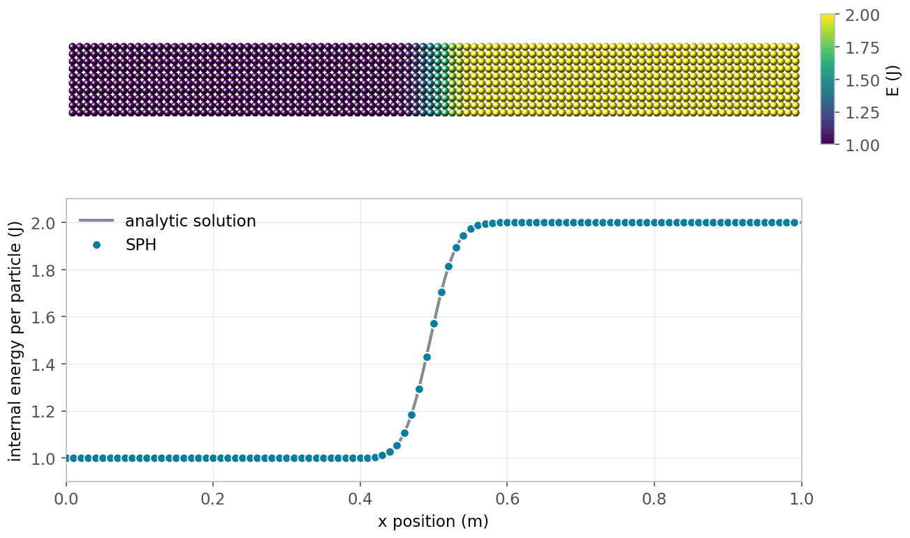
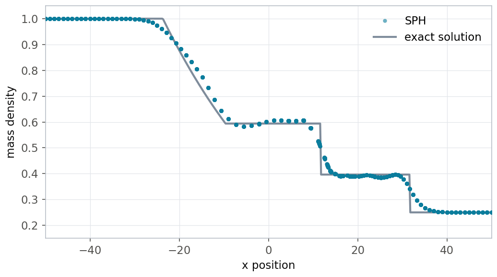
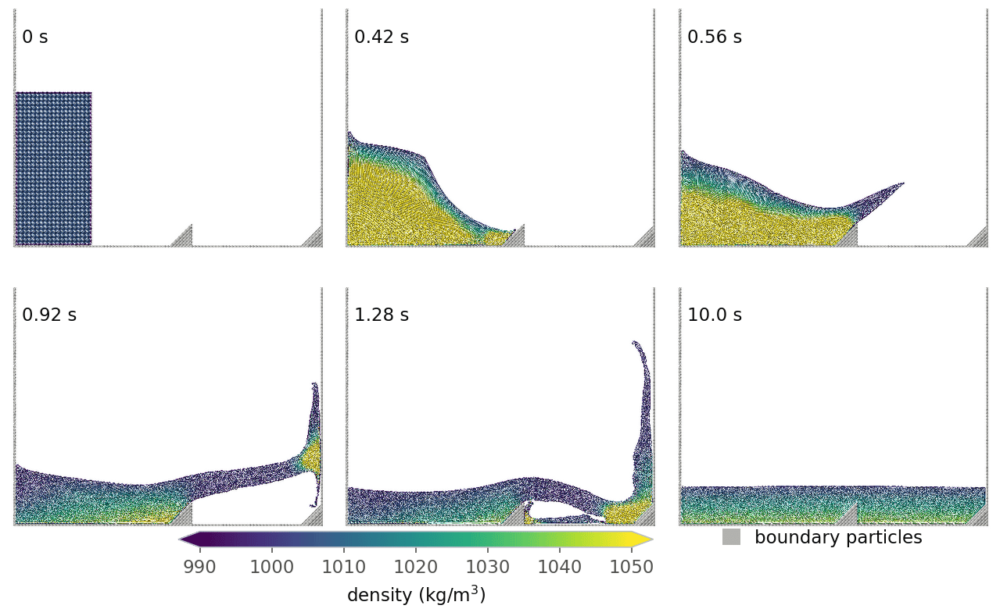
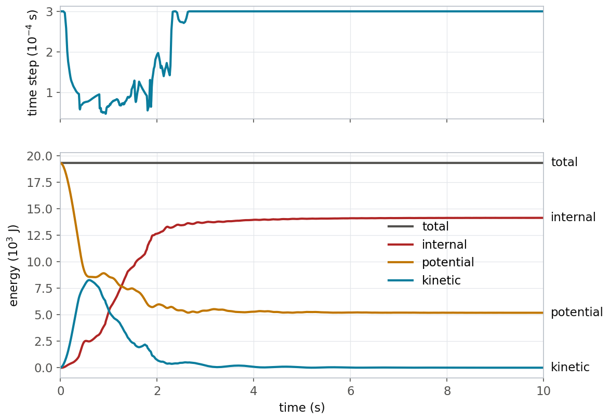
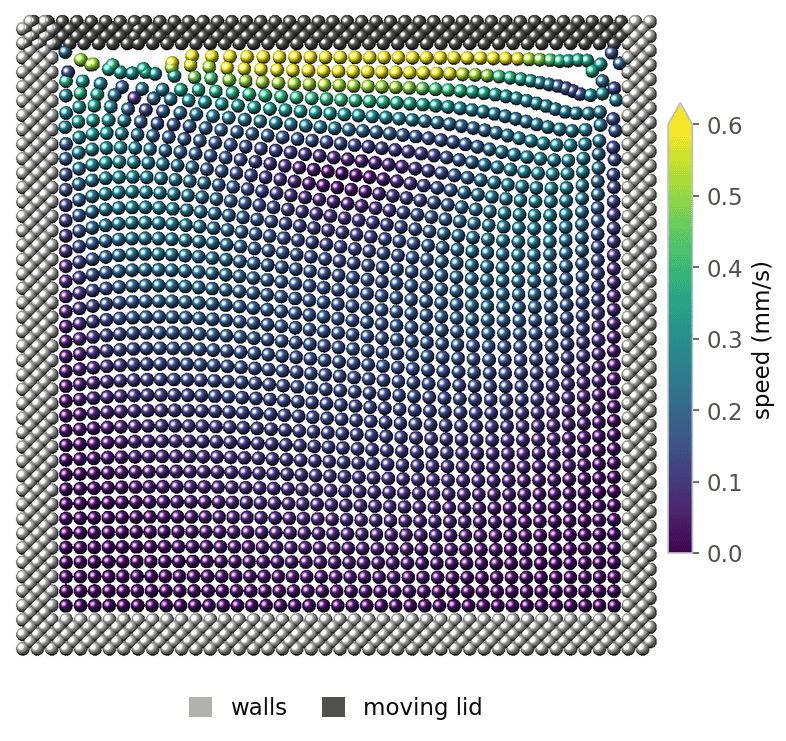

Smoothed particle hydrodynamics (SPH)
=====================================

**written by Georg C. Ganzenmueller, Martin O. Steinhauser, and Paul
Van Liedekerke in 2011, converted to reStructuredText and updated for
current LAMMPS in 2026 by Axel Kohlmeyer**

----

The :ref:`SPH package <PKG-SPH>` implements the smoothed particle
hydrodynamics (SPH) method for fluids.  This Howto gives a concise
introduction to SPH, explains how the method is implemented in LAMMPS,
and discusses the example inputs in the ``examples/PACKAGES/sph``
folder.

----

.. contents:: Contents of this Howto:
   :local:
   :depth: 2

----

Overview
""""""""

SPH is a continuum method that does not require a predefined grid to
evaluate the partial differential equations of continuum mechanics.
Instead, SPH discretizes the mass distribution of a material into point
masses (particles) which move with the material according to Newton's
equations of motion.  The positions of these particles serve as
integration points for the field equations.  The required fields, for
example the mass density or the pressure, are constructed on the fly by
interpolation with kernel functions, which are centered at the
particles.  Due to this particle nature, SPH fits well into the data
structures and the parallelization of LAMMPS: the SPH interactions are
implemented as pair styles and the time integration as fixes.

The SPH package provides:

- the :doc:`atom style sph <atom_style>`, which adds the local density,
  internal energy, heat capacity, and an extrapolated velocity to each
  particle,
- pair styles for several equations of state with artificial or laminar
  viscosity (:doc:`sph/taitwater <pair_sph_taitwater>`,
  :doc:`sph/taitwater/morris <pair_sph_taitwater_morris>`,
  :doc:`sph/idealgas <pair_sph_idealgas>`, :doc:`sph/lj <pair_sph_lj>`),
  for heat conduction (:doc:`sph/heatconduction
  <pair_sph_heatconduction>`), and for computing the density by kernel
  summation (:doc:`sph/rhosum <pair_sph_rhosum>`),
- the time integration fixes :doc:`fix sph <fix_sph>` and :doc:`fix
  sph/stationary <fix_sph_stationary>`,
- the computes :doc:`sph/rho/atom <compute_sph_rho_atom>`,
  :doc:`sph/e/atom <compute_sph_e_atom>`, and :doc:`sph/t/atom
  <compute_sph_t_atom>` for output of the per-particle SPH quantities,
- keywords *sph/rho*, *sph/e*, and *sph/cv* for the :doc:`set <set>`
  command to initialize these quantities.

Related methods are available in other packages: the :ref:`MACHDYN
package <PKG-MACHDYN>` applies SPH to solids and fluids with
material strength, see the :doc:`Howto machdyn <Howto_machdyn>` page,
and the :ref:`RHEO package <PKG-RHEO>` offers a different SPH
implementation for fluids and solids with additional features such as
thermal coupling, phase transitions, and surface tension, see the
:doc:`Howto rheo <Howto_rheo>` page.

----

.. _howto_sph_quick:

Quick start
"""""""""""

The SPH package is an optional package.  If your LAMMPS executable does
not already include it, see the :doc:`Build package <Build_package>`
page for how to enable it when compiling LAMMPS from source.

The following input is a two-dimensional version of the shock tube
problem discussed :ref:`below <howto_sph_shock>`.  It contains all
elements needed for an SPH simulation of a compressible fluid:

.. code-block:: LAMMPS

   dimension     2
   atom_style    sph
   boundary      s p p

   region        box block -100 150 -4 4 -0.1 0.1 units box
   create_box    2 box
   lattice       sq 1.0
   create_atoms  1 box
   region        right block 1 EDGE EDGE EDGE EDGE EDGE units box
   set           region right type 2

   mass          1 1.0
   mass          2 0.25
   set           type 1 sph/rho 1.0
   set           type 2 sph/rho 0.25
   set           type 1 sph/e 2.5
   set           type 2 sph/e 0.625

   pair_style    hybrid/overlay sph/rhosum 1 sph/idealgas
   pair_coeff    * * sph/rhosum 4.0
   pair_coeff    * * sph/idealgas 0.75 4.0

   compute       rho all sph/rho/atom
   compute       ie all sph/e/atom
   compute       esph all reduce sum c_ie
   variable      etot equal ke+c_esph
   thermo_style  custom step ke c_esph v_etot
   thermo_modify norm no
   thermo        50

   fix           1 all sph
   fix           2 all setforce NULL 0.0 0.0
   timestep      0.05
   run           400

Some notes on this input:

- The :doc:`atom style sph <atom_style>` is required.  The particle mass
  is set per atom type with the :doc:`mass <mass>` command.
- Each SPH particle needs an initial local density and internal
  energy, here set with the :doc:`set <set>` command.  The internal
  energy *E* stored by LAMMPS is the energy *per particle* and not the
  energy per unit mass *e*, i.e. :math:`E = m e`.  For the ideal gas
  equation of state :math:`p = (\gamma - 1)\rho e` with
  :math:`\gamma = 1.4`, the chosen values correspond to a pressure of
  1.0 for type 1 and 0.25 for type 2.
- The pair style :doc:`sph/idealgas <pair_sph_idealgas>` computes the
  pressure forces and artificial viscosity (with :math:`\alpha = 0.75`),
  and the rates of change of the local density and internal energy.
  The pair style :doc:`sph/rhosum <pair_sph_rhosum>` recomputes the
  local density by kernel summation, here every step.  Both use a kernel
  function with a range *h* of 4 lattice spacings, which is also the
  cutoff of the pair style.
- :doc:`Fix sph <fix_sph>` integrates the positions, velocities, local
  densities, and internal energies in time.  The :doc:`fix setforce
  <fix_setforce>` command zeroes the forces in *y* and *z* direction to
  turn this into a quasi one-dimensional problem.
- The total energy of the fluid is the sum of the kinetic energy and
  the internal energy of all particles.  It is monitored with the help
  of the :doc:`sph/e/atom <compute_sph_e_atom>` and :doc:`reduce
  <compute_reduce>` computes.

----

SPH theory
""""""""""

This section gives a concise introduction to SPH for fluids.  For more
detailed information, please see the books by Hoover
:ref:`(Hoover2006) <howto_sph_hoover>` and by Liu and Liu
:ref:`(Liu and Liu) <howto_sph_liu>`; this Howto follows the presentation in
the book by Hoover.  SPH solves the equations of continuum mechanics in
the Lagrangian frame, where the governing partial differential equations
describe the co-moving evolution of the mass density :math:`\rho`, the
velocity :math:`\mathbf{v}`, and the internal energy per unit mass
:math:`e` in terms of gradients of the velocity, the pressure tensor
:math:`\mathbf{P}`, and the heat flux :math:`\mathbf{Q} = -\kappa\nabla
T` with thermal conductivity :math:`\kappa` and temperature :math:`T`:

.. math::

   \frac{d\rho}{dt} & = -\rho\,\nabla\cdot\mathbf{v} \\
   \frac{d\mathbf{v}}{dt} & = -\frac{1}{\rho}\,\nabla\cdot\mathbf{P} \\
   \frac{de}{dt} & = -\frac{1}{\rho}\,\mathbf{P} : \nabla\mathbf{v}
                     - \frac{1}{\rho}\,\nabla\cdot\mathbf{Q}

where :math:`\mathbf{A}:\mathbf{B} = \sum_{\alpha\beta}
A_{\alpha\beta}B_{\alpha\beta}` denotes the double contraction of two
tensors.

Kernel interpolation
^^^^^^^^^^^^^^^^^^^^

SPH interpolates any field :math:`f(\mathbf{r})` at the position
:math:`\mathbf{r}_i` of particle *i* as a weighted sum over the values
:math:`f_j` carried by its neighbor particles *j*:

.. math::

   f(\mathbf{r}_i) = \sum_j \frac{m_j}{\rho_j}\, f_j\, W(r_{ij}, h)

Here :math:`m_j` and :math:`\rho_j` are the mass and the local density of
particle *j*, :math:`\mathbf{r}_{ij} = \mathbf{r}_i - \mathbf{r}_j`, and
:math:`r_{ij} = |\mathbf{r}_{ij}|`.  The kernel (or weight) function
:math:`W` is radially symmetric, normalized to unity, and has compact
support: it decays to zero at the distance *h*, which in LAMMPS is the
cutoff of the pair style and typically spans a few inter-particle
spacings.  Thus, only the particles within the distance *h* contribute
to the sum.  The interpolation turns the coupled set of partial
differential equations above into a set of ordinary differential
equations for the particles.

Since :math:`m_j` and :math:`f_j` are particle properties, the gradient
operator only acts on the kernel function:

.. math::

   \nabla f(\mathbf{r}_i) = \sum_j \frac{m_j}{\rho_j}\, f_j\,
   \nabla_i W_{ij}, \qquad
   \nabla_i W_{ij} = \frac{\mathbf{r}_{ij}}{r_{ij}}\,
   \frac{\partial W(r_{ij})}{\partial r_{ij}}

Because of the radial symmetry of :math:`W`, the kernel gradient is
antisymmetric: :math:`\nabla_i W_{ij} = -\nabla_j W_{ij}`.

Local density
^^^^^^^^^^^^^

Setting :math:`f \equiv \rho` in the interpolation gives the SPH
expression for the local density, which includes the contribution of
particle *i* itself:

.. math::

   \rho_i = \sum_j m_j W_{ij}

The local density computed this way is a smoothed quantity with
contributions from all particles within the distance *h*.

Equation of motion
^^^^^^^^^^^^^^^^^^

To obtain a computable expression for the acceleration, the divergence
of the pressure tensor is rewritten with the identity

.. math::

   -\frac{1}{\rho}\,\nabla\cdot\mathbf{P} \equiv
   -\nabla\cdot\frac{\mathbf{P}}{\rho} - \frac{\mathbf{P}}{\rho^2}\cdot\nabla\rho

and both gradients on the right-hand side are discretized with the SPH
gradient expression.  For a fluid with a scalar pressure :math:`P`,
this leads to a sum of pairwise forces:

.. math::

   \mathbf{f}_i = m_i \frac{d\mathbf{v}_i}{dt} =
   -\sum_j m_i m_j \left( \frac{P_i}{\rho_i^2} + \frac{P_j}{\rho_j^2}
   \right) \nabla_i W_{ij}

Due to the antisymmetry of the kernel gradient, the pair forces obey
Newton's third law and the SPH discretization conserves the total linear
momentum.

Continuity equation
^^^^^^^^^^^^^^^^^^^

Rewriting the continuity equation with the identity :math:`\nabla\cdot(\rho\mathbf{v})
= \rho\nabla\cdot\mathbf{v} + \mathbf{v}\cdot\nabla\rho` and applying the SPH
gradient expression gives the rate of change of the local density in terms
of the relative velocities :math:`\mathbf{v}_{ij} = \mathbf{v}_i - \mathbf{v}_j`:

.. math::

   \frac{d\rho_i}{dt} = \sum_j m_j\, \mathbf{v}_{ij}\cdot\nabla_i W_{ij}

Energy equation
^^^^^^^^^^^^^^^

Proceeding in the same way for the energy equation, the rate of change
of the internal energy :math:`E_i = m_i e_i` of particle *i* due to
compression or expansion is:

.. math::

   \frac{dE_i}{dt} = \frac{1}{2} \sum_j m_i m_j \left( \frac{P_i}{\rho_i^2}
   + \frac{P_j}{\rho_j^2} \right) \mathbf{v}_{ij}\cdot\nabla_i W_{ij}

The energy change due to heat conduction is discussed :ref:`below
<howto_sph_heat>`.

Artificial viscosity
^^^^^^^^^^^^^^^^^^^^

Numerical integration of the compressible Navier-Stokes equations is
generally unstable in the sense that small pressure waves can steepen
due to numerical artifacts and turn into shock waves.  To suppress this
source of instability, Monaghan introduced an extension of the von
Neumann-Richtmyer artificial viscosity into SPH :ref:`(Monaghan)
<howto_sph_monaghan>`.  An additional viscous term :math:`\Pi_{ij}` is
added to the pressure terms in the force and energy expressions:

.. math::

   \mathbf{f}_i & = -\sum_j m_i m_j \left( \frac{P_i}{\rho_i^2}
   + \frac{P_j}{\rho_j^2} + \Pi_{ij} \right) \nabla_i W_{ij} \\
   \frac{dE_i}{dt} & = \frac{1}{2}\sum_j m_i m_j \left( \frac{P_i}{\rho_i^2}
   + \frac{P_j}{\rho_j^2} + \Pi_{ij} \right) \mathbf{v}_{ij}\cdot\nabla_i W_{ij}

with

.. math::

   \Pi_{ij} = -\alpha\, \frac{c_i + c_j}{\rho_i + \rho_j}\;
   \frac{h\, \mathbf{v}_{ij}\cdot\mathbf{r}_{ij}}{r_{ij}^2 + \epsilon h^2}
   \quad\text{for}\quad \mathbf{v}_{ij}\cdot\mathbf{r}_{ij} < 0,
   \qquad \Pi_{ij} = 0 \quad\text{otherwise}

Here, :math:`c_i` and :math:`c_j` are the speeds of sound of particles
*i* and *j*, :math:`\alpha` is a dimensionless factor controlling the
strength of the dissipation, and :math:`\epsilon = 0.01` avoids a
singularity when particles are very close.  The viscous term only acts
between particles that approach each other.  Following
:ref:`(Gonzalez) <howto_sph_gonzalez>`, the artificial viscosity can be
related to an effective kinematic viscosity :math:`\nu \approx \alpha h
c / 8`.

Laminar flow viscosity
^^^^^^^^^^^^^^^^^^^^^^

While the artificial viscosity usually gives good results for turbulent
flows, the velocity profiles of flows at low Reynolds numbers may be
inaccurate.  Morris et al. :ref:`(Morris) <howto_sph_morris>` proposed
an expression for the viscous term of the Navier-Stokes equations
similar to the one used for heat conduction.  With a dynamic viscosity
:math:`\mu = \rho\nu`, the viscous force and the corresponding viscous
heating are:

.. math::

   \mathbf{f}_i^\text{visc} & = \sum_j \frac{2 m_i m_j \mu}{\rho_i \rho_j}\,
   \frac{1}{r_{ij}}\frac{\partial W}{\partial r_{ij}}\; \mathbf{v}_{ij} \\
   \left.\frac{dE_i}{dt}\right|^\text{visc} & = -\frac{1}{2}\sum_j
   \frac{2 m_i m_j \mu}{\rho_i \rho_j}\,
   \frac{1}{r_{ij}}\frac{\partial W}{\partial r_{ij}}\; v_{ij}^2

These terms replace the artificial viscosity in the force and energy
expressions.

Time step
^^^^^^^^^

As for any explicit time integration scheme, the time step
:math:`\Delta t` must be small enough that information cannot propagate
farther than a fraction of the kernel range per step.  This
Courant-Friedrichs-Lewy (CFL) criterion is typically formulated as
:math:`\Delta t \le C_\text{CFL}\, h / c`, with *c* the speed of sound
and :math:`C_\text{CFL}` about 0.1 to 0.3.  For laminar flows, the time
step can be limited by viscous diffusion rather than by the CFL
criterion.  A stable simulation should then also fulfill
:math:`\Delta t < 0.125\, h^2/\nu`.

----

Implementation in LAMMPS
""""""""""""""""""""""""

Per-particle data
^^^^^^^^^^^^^^^^^

LAMMPS provides data structures for positions, velocities, and forces.
SPH requires at least four additional per-particle quantities: the local
density :math:`\rho`, the internal energy :math:`E = m e`, and their
time derivatives :math:`\dot\rho` and :math:`\dot E`.  These are added
by the :doc:`atom style sph <atom_style>`, which also stores a
per-particle heat capacity :math:`C_V`, so that a per-particle
temperature :math:`T = E/C_V` can be computed, and an extrapolated
velocity (see below).  With both :math:`\rho` and :math:`E` available,
complete equations of state, i.e. equations of state that depend on
density and temperature, are supported.

Kernel functions
^^^^^^^^^^^^^^^^

All SPH pair styles have the kernel range *h* as their last
:doc:`pair_coeff <pair_coeff>` parameter, which is also the cutoff of
the interaction.  The pair styles that compute forces, heat conduction,
and density changes use the Lucy kernel :ref:`(Lucy)
<howto_sph_lucy>`, while the pair style :doc:`sph/rhosum
<pair_sph_rhosum>` uses a quartic polynomial kernel, which does not
require evaluating a square root:

.. math::

   W_\text{Lucy}(r < h) & = \frac{1}{s} \left( 1 + 3\frac{r}{h} \right)
   \left( 1 - \frac{r}{h} \right)^3 \\
   W_\text{quartic}(r < h) & = \frac{1}{s} \left( 1 - \frac{r^2}{h^2} \right)^4

The normalization constants *s* depend on the dimension of the system;
both two- and three-dimensional systems are supported.

Time integration
^^^^^^^^^^^^^^^^

LAMMPS integrates the equations of motion with the velocity-Verlet
algorithm.  This scheme cannot be used unchanged for SPH, because the
velocities lag behind the positions by half a time step when the forces
are computed.  Since the SPH expressions for the density and energy
changes depend explicitly on the velocities, this would lead to poor
conservation of mass and energy.  The situation is improved by computing
an extrapolated velocity

.. math::

   \tilde{\mathbf{v}}_i(t + \Delta t) = \mathbf{v}_i(t)
   + \frac{\Delta t}{m_i}\,\mathbf{f}_i(t)

before the forces are computed, and using :math:`\tilde{\mathbf{v}}` in
all SPH pair styles.  This extrapolation is only accurate to first order
in :math:`\Delta t`.  The local density and the internal energy are
integrated in two half steps, in analogy to the velocities, since a
simple Euler integration of these quantities would lead to poor energy
conservation.  The complete scheme implemented by :doc:`fix sph
<fix_sph>` for each time step reads:

#. :math:`\mathbf{v}_i(t + \frac{1}{2}\Delta t) = \mathbf{v}_i(t)
   + \frac{\Delta t}{2 m_i}\mathbf{f}_i(t)`
#. :math:`\tilde{\mathbf{v}}_i(t + \Delta t) = \mathbf{v}_i(t)
   + \frac{\Delta t}{m_i}\mathbf{f}_i(t)`
#. :math:`\rho_i(t + \frac{1}{2}\Delta t) = \rho_i(t)
   + \frac{\Delta t}{2}\dot\rho_i(t)` and
   :math:`E_i(t + \frac{1}{2}\Delta t) = E_i(t)
   + \frac{\Delta t}{2}\dot E_i(t)`
#. :math:`\mathbf{r}_i(t + \Delta t) = \mathbf{r}_i(t)
   + \Delta t\,\mathbf{v}_i(t + \frac{1}{2}\Delta t)`
#. compute :math:`\mathbf{f}_i(t + \Delta t)`, :math:`\dot\rho_i(t +
   \Delta t)`, and :math:`\dot E_i(t + \Delta t)` with the pair styles
#. :math:`\rho_i(t + \Delta t) = \rho_i(t + \frac{1}{2}\Delta t)
   + \frac{\Delta t}{2}\dot\rho_i(t + \Delta t)` and
   :math:`E_i(t + \Delta t) = E_i(t + \frac{1}{2}\Delta t)
   + \frac{\Delta t}{2}\dot E_i(t + \Delta t)`
#. :math:`\mathbf{v}_i(t + \Delta t) = \mathbf{v}_i(t + \frac{1}{2}\Delta t)
   + \frac{\Delta t}{2 m_i}\mathbf{f}_i(t + \Delta t)`

:doc:`Fix sph/stationary <fix_sph_stationary>` integrates only the local
density and the internal energy and leaves positions and velocities
unchanged.  It is used for boundary particles, see below.

Since the SPH equations are stiff, the time step is often chosen
adaptively with the :doc:`fix dt/reset <fix_dt_reset>` command, which
reduces the time step during violent parts of a flow and enlarges it
when the flow calms down.  This is demonstrated in the :ref:`water
collapse example <howto_sph_water>` below.

Local density
^^^^^^^^^^^^^

The pair styles that compute forces also compute the rate of change of
the local density from the continuity equation, which is then integrated
in time by the fix.  This requires a consistent initial value for the
local density of each particle, which can be set with the *sph/rho*
keyword of the :doc:`set <set>` command or read from a data file.  The
initial densities must be consistent with the particle masses and the
particle spacing, otherwise the results will be poor.

Alternatively, the local density can be recomputed from scratch with the
kernel summation by adding the pair style :doc:`sph/rhosum
<pair_sph_rhosum>` through :doc:`pair_style hybrid/overlay
<pair_hybrid>`.  Its argument *Nstep* determines how often the summation
is performed.  On all other steps, the density is updated with the
continuity equation.  The summation underestimates the density of
particles close to a free surface or a boundary, where neighbors are
missing.  In the water collapse example below, the summation is
therefore only applied to the water particles but not to the boundary
particles.

Equations of state
^^^^^^^^^^^^^^^^^^

The equation of state determines the pressure as a function of the
local density and, for complete equations of state, the internal energy.
Each equation of state is implemented as a separate pair style that also
includes the viscosity model:

.. list-table::
   :header-rows: 1
   :widths: 25 40 35

   * - Pair style
     - Equation of state
     - Viscosity
   * - :doc:`sph/taitwater <pair_sph_taitwater>`
     - Tait equation of state for water
     - artificial viscosity
   * - :doc:`sph/taitwater/morris <pair_sph_taitwater_morris>`
     - Tait equation of state for water
     - laminar viscosity (Morris)
   * - :doc:`sph/idealgas <pair_sph_idealgas>`
     - ideal gas with :math:`\gamma = 1.4`
     - artificial viscosity
   * - :doc:`sph/lj <pair_sph_lj>`
     - Lennard-Jones fluid
     - artificial viscosity

The Tait equation of state

.. math::

   P(\rho) = \frac{c_0^2\rho_0}{7}\left[ \left( \frac{\rho}{\rho_0}
   \right)^7 - 1 \right]

is an incomplete equation of state devised to model water at ambient
conditions; :math:`c_0` and :math:`\rho_0` are the speed of sound and
the density at zero pressure.  For simulations of incompressible
flows, it is common to choose a speed of sound much smaller than that of
real water, but still about ten times larger than the largest flow
velocity, so that density fluctuations remain small while the time step
can be much larger.  The ideal gas equation of state :math:`P = (\gamma
- 1)\rho e` uses a fixed heat capacity ratio :math:`\gamma = C_p/C_V =
1.4`, corresponding to dry air.  The Lennard-Jones equation of state is
the continuum equivalent of a fluid of particles interacting with the
Lennard-Jones pair potential.  It uses the parametrization of Ree
:ref:`(Ree) <howto_sph_ree>` with :math:`\epsilon` and :math:`\sigma`
set to unity.

.. _howto_sph_heat:

Heat conduction
^^^^^^^^^^^^^^^

Heat conduction between SPH particles is computed by the pair style
:doc:`sph/heatconduction <pair_sph_heatconduction>`.  It only changes
the internal energy of the particles,

.. math::

   \left.\frac{dE_i}{dt}\right|^\text{cond} = \sum_j \frac{2 m_i m_j}{m_i + m_j}\,
   \frac{\rho_i + \rho_j}{\rho_i \rho_j}\, D\, (E_i - E_j)\,
   \frac{1}{r_{ij}}\frac{\partial W}{\partial r_{ij}}

where *D* is the heat diffusion coefficient (thermal diffusivity) with
units of length\ :sup:`2`/time.  It is related to the thermal
conductivity by :math:`D = \kappa/(\rho c_V)`, with :math:`c_V` the heat
capacity per unit mass.  To combine heat conduction with fluid flow,
the pair style is added through :doc:`pair_style hybrid/overlay
<pair_hybrid>`.

Boundary conditions
^^^^^^^^^^^^^^^^^^^

In macroscopic simulations, it is often desirable to confine a fluid to
a region of space.  One possibility is to use one of the :doc:`fix wall
<fix_wall>` commands.  However, such walls result in poor energy
conservation.  It is usually better to represent the walls with
stationary SPH particles, which take part in the SPH summations, but are
only integrated with :doc:`fix sph/stationary <fix_sph_stationary>`, so
that only their local density and internal energy change.  Please note
that even though these boundary particles have zero velocity, the SPH
interpolated velocity at their positions is not zero.  This results in
errors near the boundary, e.g. for the velocity profile of a laminar
flow.

Initialization and output
^^^^^^^^^^^^^^^^^^^^^^^^^

The local density, internal energy, and heat capacity of the particles
can be set with the *sph/rho*, *sph/e*, and *sph/cv* keywords of the
:doc:`set <set>` command or read from the *Atoms* section of a data
file.  The format of a line in that section for atom style *sph* is
given on the :doc:`read_data <read_data>` page.

The current values of these quantities can be output with the computes
:doc:`sph/rho/atom <compute_sph_rho_atom>`, :doc:`sph/e/atom
<compute_sph_e_atom>`, and :doc:`sph/t/atom <compute_sph_t_atom>`
(temperature :math:`T = E/C_V`), or with the *rho*, *drho*, *e*, *de*,
and *cv* properties of :doc:`compute property/atom
<compute_property_atom>`.  The resulting per-atom vectors can be used
with :doc:`dump custom <dump>`, or summed up for thermodynamic output
with :doc:`compute reduce <compute_reduce>`.  For a quick look at a
simulation, the :doc:`dump image <dump_image>` command can color the
particles by any of these quantities.

----

Examples
""""""""

The following examples are included in the ``examples/PACKAGES/sph``
folder.  They also served as validation tests of the implementation.
Some of the inputs run only a small number of time steps by default, so
that they can be used for regression testing.  The number of steps is
then set by the index style variable *nsteps*, which can be changed with
the :ref:`-var command-line switch <var>`, e.g. ``lmp -in
in.water_collapse -var nsteps 50000``.  The README file in the folder
lists the values needed for the complete examples, which were used for
the figures below.

Heat conduction
^^^^^^^^^^^^^^^

The input ``heatconduction/in.sph_heat_conduction_2d`` sets up a 2d bar
of SPH particles with dimensions 100 cm by 10 cm and a particle
spacing of 1 cm in SI units.  The left half is assigned an internal
energy of 1 J per particle, the right half 2 J per particle.  Heat flows
from right to left with a heat diffusion coefficient of :math:`1.0 \times
10^{-4}` m\ :sup:`2`/s.  All particles are integrated with :doc:`fix
sph/stationary <fix_sph_stationary>`, so they do not move, and there is
neither potential nor kinetic energy.  The total energy is thus the sum
of the internal energies, which is computed and output with:

.. code-block:: LAMMPS

   set             group all sph/rho 0.1 # = particle mass / particle area
   pair_style      sph/heatconduction
   #               i j diffusion coeff. cutoff
   pair_coeff      1 1 1.0e-4           2.0e-2

   compute         ie_atom all sph/e/atom
   compute         ie all reduce sum c_ie_atom
   thermo_style    custom step temp c_ie
   fix             integrate_fix all sph/stationary

The analytic solution to this problem is obtained from the 1d diffusion
equation:

.. math::

   E(x,t) = E_l + \frac{E_r - E_l}{2}\left[ 1 + \text{erf}
   \left( \frac{x - x_c}{\sqrt{4 D t}} \right) \right]

Here, :math:`E_l` and :math:`E_r` are the initial energies on the left
and right sides, :math:`x_c` is the position of the contact between the
cold and hot regions, *D* is the diffusion coefficient, and *t* is time.
The figure below shows the good agreement between the SPH results and
the analytic solution.  The folder also contains a 3d version of this
example and a gnuplot script that compares the final profile with the
analytic solution.

   Heat conduction example at t = 4 s.  Top: the particles colored by
   their internal energy.  Bottom: internal energy of the particles as a
   function of their position compared to the analytic solution.

.. _howto_sph_shock:

Shock tube
^^^^^^^^^^

This example considers the solution of a quasi-1d shock wave problem in 2
or 3 dimensions (inputs ``shock_tube/in.shock2d`` and
``shock_tube/in.shock3d``).  It is adapted from Monaghan's investigation
of the performance of SPH for a 1d shock wave problem :ref:`(Monaghan)
<howto_sph_monaghan>`.  In reduced units, the initial conditions are two
regions of an ideal gas: a high density region on the left with
:math:`P = \rho = 1` in contact with a low density region on the right
with :math:`P = \rho = 0.25`.  As the high density gas expands into the
low density region, a shock wave travels to the right while a
rarefaction wave travels to the left.  The particles are arranged on a
square (simple cubic) lattice with spacing 1, extending from *x* = -100
to 150 and *y* = -4 to 4 (and *z* = -4 to 4 in 3d), with periodic
boundaries in *y* and *z*.  The particles with negative *x* coordinate
have mass 1 and those with positive *x* coordinate have mass 0.25.  The
density is computed by kernel summation every step, and the artificial
viscosity parameter is :math:`\alpha = 0.75`.  The 2d input is very
similar to the :ref:`quick start example <howto_sph_quick>` above.

The SPH results agree well with the exact solution of the corresponding
Riemann problem, which is included in the file
``shock_tube/exact_solution.dat``.  The shock front and the contact
discontinuity are smeared out over a distance of about *h*.  The total
energy, i.e. the sum of kinetic and internal energy, is conserved to
better than one part per million.

   Mass density of the particles in the 3d shock tube example at t = 20
   (400 steps) compared to the exact solution.

.. _howto_sph_water:

Collapse of a water column
^^^^^^^^^^^^^^^^^^^^^^^^^^

The input ``water_collapse/in.water_collapse`` simulates a prototypical
test for SPH: the collapse of a water column in a rectangular container
with an obstacle :ref:`(Gomez-Gesteira) <howto_sph_gomez>`.  The
geometry is read from the data file ``data.initial``: a water column of
1 m by 2 m (type 1) in a container with a wedge-shaped obstacle
that is represented by stationary SPH particles (type 2).  Water is
modeled with the Tait equation of state with :math:`c_0 = 10` m/s,
:math:`\rho_0 = 1000` kg/m\ :sup:`3`, and an artificial viscosity of
:math:`\alpha = 1`.  The density of the water particles is recomputed by
kernel summation every step.

.. code-block:: LAMMPS

   variable     h equal 0.03
   variable     c equal 10.0 # soundspeed for Tait's EOS
   variable     dt equal 0.1*${h}/${c} # upper limit of timestep from CFL criterion

   pair_style   hybrid/overlay sph/rhosum 1 sph/taitwater
   pair_coeff   * * sph/taitwater 1000.0 ${c} 1.0 ${h}
   pair_coeff   1 1 sph/rhosum ${h}

   fix          gfix water gravity -9.81 vector 0 1 0
   fix          2d_fix all enforce2d
   # variable timestep: the fastest particle moves at most 0.0005 m per step
   fix          dtfix all dt/reset 1 NULL ${dt} 0.0005 units box
   fix          integrate_water_fix water sph
   fix          integrate_bc_fix bc sph/stationary

The :doc:`fix gravity <fix_gravity>` command applies a downward force and
also computes the potential energy of the water in the gravitational
field, which is needed to monitor the conservation of the total energy.
To deal efficiently with the time integration, a variable time step is
used: the time step is chosen such that the fastest particle may move no
more than 0.0005 m per step.  Additionally, the time step is limited by
the CFL criterion :math:`\Delta t < 0.1 h/c`.

   Snapshots of the water collapse example (lower part of the
   container).  The water particles are colored by their local density
   and the boundary particles are gray.  As the water column collapses,
   a wave splashes over the obstacle and hits the right container wall
   before the water settles.

The importance of the variable time step is demonstrated in the next
figure.  If a fixed time step were used instead, it would need to be set
to the smallest value attained in this simulation to achieve the same
degree of energy conservation.  In contrast, the variable time step is
only reduced when needed during the violent initial collapse of the
column, when kinetic energy is converted into internal energy by viscous
dissipation, and not during the comparatively well-ordered flow
afterwards.  The total energy is conserved to about 25 parts per
million.

   Water collapse example.  Top: time step selected by fix dt/reset.
   Bottom: kinetic energy, internal energy, potential energy in the
   gravitational field, and total energy.

Shear cavity flow
^^^^^^^^^^^^^^^^^

The shear-driven cavity flow is a standard test for laminar flow
(input ``cavity_flow/in.cavity_flow``).  A 2d square of fluid
particles is enclosed by stationary wall particles on three sides (type
2), while a strip of particles on top (type 3) moves at a constant speed
of :math:`10^{-3}` m/s.  The fluid is modeled with the Tait equation of
state combined with the laminar flow viscosity of Morris et al., with a
kinematic viscosity of :math:`\nu = 10^{-6}` m\ :sup:`2`/s.  The moving
strip is integrated with :doc:`fix sph <fix_sph>`, while its forces are
set to zero with :doc:`fix setforce <fix_setforce>`, so that it keeps its
velocity.  Interactions between the walls and the moving strip are
turned off.

.. code-block:: LAMMPS

   pair_style   hybrid sph/taitwater/morris
   #            rho0 c0  viscosity h
   pair_coeff   * * sph/taitwater/morris 1000 0.1 1.0e-3 6.5e-5
   pair_coeff   2 3 none # exclude interaction between walls and shear driver

   velocity     driver set 0.001 0.0 0.0 units box
   fix          freeze_fix driver setforce 0.0 0.0 0.0
   fix          integrate_fix_full integrate_full sph
   fix          integrate_fix_stationary walls sph/stationary

The moving strip drives a laminar vortex inside the cavity.  The kinetic
energy of the fluid levels off after about 0.1 s, so the 0.2 s of
simulated time of the example input are sufficient to establish the
vortex.  In the original validation of the package, the horizontal
velocity profile along the vertical center line of the cavity agreed
well with a finite difference solution.

   Shear cavity example at the end of the simulation.  The fluid
   particles are colored by their speed, the wall particles are gray, and
   the moving strip on top is dark gray.

----

References
""""""""""

.. _howto_sph_hoover:

**(Hoover2006)** Hoover, Smooth Particle Applied Mechanics: The State of
the Art, World Scientific, Singapore (2006).

.. _howto_sph_liu:

**(Liu and Liu)** Liu and Liu, Smoothed Particle Hydrodynamics: A Meshfree
Particle Method, World Scientific, Singapore (2003).

.. _howto_sph_monaghan:

**(Monaghan)** Monaghan and Gingold, J Comput Phys, 52, 374-389 (1983).

.. _howto_sph_gonzalez:

**(Gonzalez)** Gonzalez, Sanchez, Macia, Souto-Iglesias, Analysis of
WCSPH laminar viscosity models, 4th international SPHERIC workshop,
Nantes, France (2009).

.. _howto_sph_morris:

**(Morris)** Morris, Fox, Zhu, J Comput Phys, 136, 214-226 (1997).

.. _howto_sph_lucy:

**(Lucy)** Lucy, Astronomical Journal, 82, 1013-1024 (1977).

.. _howto_sph_ree:

**(Ree)** Ree, J Chem Phys, 73, 5401 (1980).

.. _howto_sph_gomez:

**(Gomez-Gesteira)** Gomez-Gesteira, Rogers, Dalrymple, Crespo, J
Hydraulic Res, 48, 6-27 (2010).
