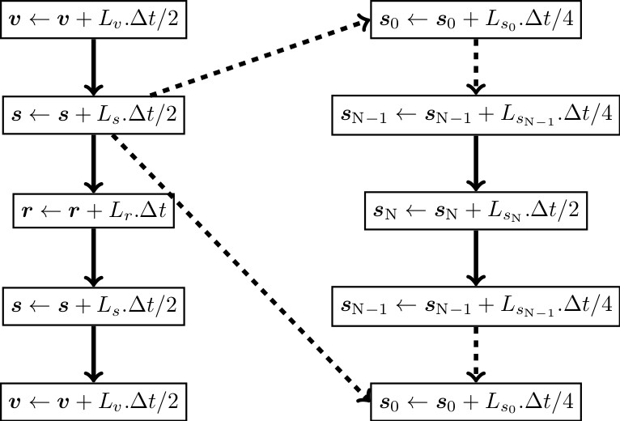

.. index:: fix nve/spin

fix nve/spin command
====================

Syntax
""""""

.. code-block:: LAMMPS

   fix ID group-ID nve/spin keyword values

* ID, group-ID are documented in :doc:`fix <fix>` command
* nve/spin = style name of this fix command
* keyword = *lattice*

  .. parsed-literal::

       *lattice* value = *moving* or *frozen*
         moving = integrate both spin and atomic degrees of freedom
         frozen = integrate spins on a fixed lattice

Examples
""""""""

.. code-block:: LAMMPS

   fix 3 all nve/spin lattice moving
   fix 1 all nve/spin lattice frozen

Description
"""""""""""

Perform a symplectic integration for the spin or spin-lattice system.

The *lattice* keyword defines if the spins are integrated on a lattice
of fixed atoms (lattice = frozen), or if atoms are moving
(lattice = moving).
The first case corresponds to a spin dynamics calculation, and
the second to a spin-lattice calculation.
By default a spin-lattice integration is performed (lattice = moving).

The *nve/spin* fix applies a Suzuki-Trotter decomposition to
the equations of motion of the spin lattice system, following the scheme:

according to the implementation reported in :ref:`(Omelyan) <Omelyan1>`.

A sectoring method enables this scheme for parallel calculations.
The implementation of this sectoring algorithm is reported
in :ref:`(Tranchida) <Tranchida1>`.
Each processor sub-domain is cut in two halves (sectors) along every
direction in which the simulation box is divided between several
processors (see the :doc:`processors <processors>` command), giving 2,
4, or 8 sectors.  Spins in sectors with the same index on different
processors do not interact and are updated at the same time.  This
requires the sub-domain of each processor to be at least twice as wide
as the largest magnetic pair cutoff plus the :doc:`neighbor skin
distance <neighbor>` in each of these directions.  The skin is needed
because atoms can move by up to half the skin distance between two
neighbor list builds.  There is no size requirement in directions that
are not divided between processors, so that, e.g., thin films can be run
in parallel with a processor grid like "processors \* \* 1".  With
:doc:`comm_style tiled <comm_style>`, all directions are cut in two.

.. versionchanged:: TBD

   Sectors are only created in directions divided between processors
   (before, 2x2x2 sectors were always required), the size requirement
   includes the neighbor skin, and it is checked again whenever the
   sub-domains change.

----------

Restrictions
""""""""""""

This fix style can only be used if LAMMPS was built with the SPIN
package.  See the :doc:`Build package <Build_package>` page for more
info.

To use the spin algorithm, it is necessary to define a map with
the atom_modify command. Typically, by adding the command:

.. code-block:: LAMMPS

   atom_modify map array

before you create the simulation box. Note that the keyword "hash"
instead of "array" is also valid.

When running on multiple processors with a moving lattice, the sectoring
algorithm relies on atoms moving less than half the neighbor skin
distance between two neighbor list builds.  This is only guaranteed
with the settings

.. code-block:: LAMMPS

   neigh_modify every 1 delay 0 check yes

With other settings (e.g. *every* > 1 or *delay* > 0), a warning is
printed, and another one if atoms did move too far during the run
(i.e. if there are "dangerous builds"), since then spins of atoms on
different processors may have been updated in the wrong order.

Related commands
""""""""""""""""

:doc:`atom_style spin <atom_style>`, :doc:`fix nve <fix_nve>`

Default
"""""""

The option default is lattice = moving.

----------

.. _Omelyan1:

**(Omelyan)** Omelyan, Mryglod, and Folk. Phys. Rev. Lett.
86(5), 898. (2001).

.. _Tranchida1:

**(Tranchida)** Tranchida, Plimpton, Thibaudeau and Thompson,
Journal of Computational Physics, 372, 406-425, (2018).
