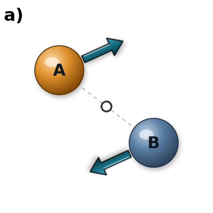
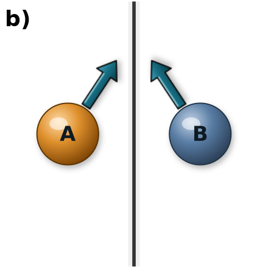
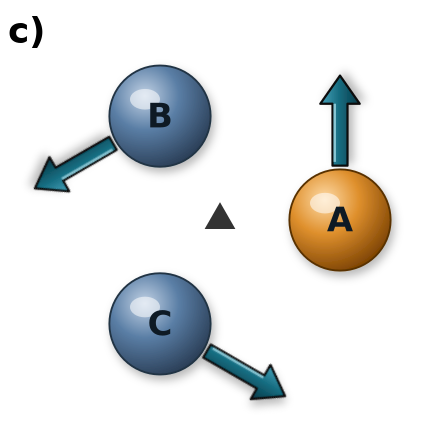
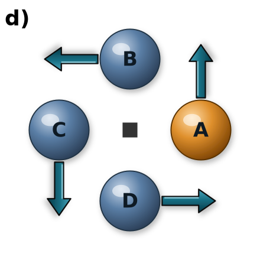

.. index:: fix symmetry

fix symmetry command
====================

Syntax
""""""

.. code-block:: LAMMPS

   fix ID group-ID symmetry file keyword value ...

* ID, group-ID are documented in :doc:`fix <fix>` command
* symmetry = style name of this fix command
* file = name of a JSON file with the symmetry operators of a space group
* zero or more keyword/value pairs may be appended
* keyword = *tol*

  .. parsed-literal::

       *tol* value = epsilon
         epsilon = tolerance for symmetric positions in fractional coordinates

Examples
""""""""

.. code-block:: LAMMPS

   fix sym all symmetry p-1.json
   fix sym crystal symmetry fm-3m.json tol 1.0e-5

Example input scripts available: examples/PACKAGES/symmetry

Description
"""""""""""

.. versionadded:: TBD

This fix keeps the atoms in its group exactly symmetric under the
operations of a crystallographic space group :ref:`(Wyckoff)
<Wyckoff1922>` during molecular dynamics and energy minimization.  For
example, with the inversion through the origin of the simulation box as
the only symmetry operation (space group P-1), every atom has a partner
at the inverted position, and this fix keeps each pair at inverted
positions with opposite velocities and forces for the entire simulation.
The method follows :ref:`(Cox) <Cox2022>` and the `symd
<https://github.com/whitead/symd>`_ reference implementation.

Purpose and typical use
"""""""""""""""""""""""

If the forces in a system are symmetric, the exact equations of motion
would preserve the symmetry.  Ordinary MD simulations, however, do not
typically achieve this because round-off errors can break the symmetry
slightly, and these deviations grow exponentially, so that after some
time the symmetry is lost.  The example input
``examples/PACKAGES/symmetry/in.lj_pinv`` shows this for 8 LJ atoms:
after the fix is removed, a displacement of 1.0e-4 grows to a clear
violation of the symmetry within a few thousand steps.  With this fix
included, the symmetry becomes an input parameter that holds exactly,
and any motion that would break, it is not possible.  This is different
from a restraint, which only adds a force that pulls the system towards
a symmetric arrangement.

Typical uses are:

* Crystal structure prediction :ref:`(Cox) <Cox2022>`: since there are
  only 230 space groups, the same composition can be equilibrated or
  relaxed under each candidate space group.  Comparing the energies of
  the resulting structures, and testing which of them remain stable in a
  subsequent unconstrained simulation, identifies stable and metastable
  structures.
* Relaxation of a crystal structure while keeping its symmetry, e.g.
  with :doc:`minimize <minimize>` and :doc:`fix box/relax
  <fix_box_relax>`.
* Equilibration of a structure that would otherwise collapse or
  transform into a lower symmetry structure, e.g. to prepare a
  metastable phase or to study a high-symmetry phase that is only stable
  at different conditions.

A practical workflow is to build a symmetric structure, relax or
equilibrate it with this fix, and then remove the fix to continue with
ordinary MD and test whether the structure is stable or breaks the
symmetry.  This is particularly helpful in combination with force fields
that have no explicit bonded interactions, e.g. manybody potentials,
ReaxFF, or machine learning interaction potentials (MLIAP), where the
(local) structure could be temporarily preserved by increasing the force
constants.

Terminology
"""""""""""

* A *symmetry operator* maps the fractional coordinates :math:`s` of a
  position in the simulation box to :math:`s' = R\,s + t` with an integer
  matrix :math:`R` and a translation :math:`t`, e.g. a rotation about an
  axis, a reflection at a mirror plane, or an inversion through a point.
* A *space group* is a set of symmetry operators that is closed: the
  combination of any two operators is also part of the set, up to a
  translation by a box vector.  It always includes the identity.
* An *orbit* is a set of atoms that are images of each other under the
  operators.  An atom and its images form one orbit.  The atoms in the
  fix group must consist of complete orbits, i.e. the image of every atom
  in the group under every operator must be an atom of the group.
* An atom on a *special position* sits on a symmetry element, e.g. on a
  mirror plane or an inversion center, and is its own image under one or
  more operators (its *site symmetry*).  Its orbit then has fewer atoms
  than the space group has operators, and the atom can only move in the
  directions that the site symmetry allows, e.g. within the mirror plane.

The fix does not create atoms.  The atoms in the fix group make up the
symmetric system: they must be placed at symmetric positions before the
run, e.g. with :doc:`create_atoms <create_atoms>` using a lattice or with
:doc:`read_data <read_data>`.  The fix finds the orbits from the
positions when a run or minimization starts.

How it works
""""""""""""

|sym_inv|  |sym_mir|  |sym_r3|  |sym_r4|

The figures show orbits for four operators: a) an inversion center, b) a
mirror plane, c) a three-fold, and d) a four-fold rotation axis.  In
each orbit, the atom A (amber) is the representative and B, C, D (blue)
are its images.  For each orbit, the fix maps the forces of all atoms
back to the representative with the inverse operators, averages them,
and assigns the images of the average to all atoms of the orbit
(arrows).  With the Cartesian forms :math:`M_k` of the operators
(rotations or reflections when the box fits the space group), the force
on the representative of an orbit with :math:`n` atoms is

.. math::

   \mathbf{F}_\mathrm{rep} = P\,\frac{1}{n}\sum_{m=1}^{n} M_{k(m)}^{-1}\,\mathbf{f}_m

where :math:`k(m)` is an operator that maps the representative onto atom
:math:`m` and :math:`P` projects onto the directions in which an atom on
a special position can move (the identity on a general position).  The
force on atom :math:`m` becomes :math:`M_{k(m)}\,\mathbf{F}_\mathrm{rep}`.
The same is done for the velocities.  The positions of all atoms are
reset to the images of the position of their representative, and a
representative on a special position is moved back exactly onto it.

The symmetric positions form a linear subspace of all coordinates, and
the averaged force is the exact projection of the forces onto this
subspace.  The resulting dynamics is that of the independent coordinates
under the original potential, integrated with the same velocity Verlet
algorithm.  Starting from a symmetric configuration, the trajectory is
therefore the same as without the fix, only without the growing
deviations from symmetry.  The unit tests for this fix confirm this to
round-off for several space groups.  Total energy is conserved as in
ordinary MD.

Symmetry file
"""""""""""""

The symmetry file is in JSON format and lists the operators of the space
group, e.g. for the space group Pmm2 with mirror planes perpendicular to
x and y and a two-fold rotation axis along z:

.. code-block:: json

   {
     "group_name": "Pmm2",
     "ops": [ "x,y,z", "-x,-y,z", "-x,y,z", "x,-y,z" ]
   }

* The operators act on fractional coordinates of the simulation box.
  They are written in the coordinate triplet notation of the
  International Tables for Crystallography :ref:`(ITA) <ITA2016>` and of
  `CIF files
  <https://cif-dictionaries.iucr.org/cifdic/dichtm.php?dic=cif_core&show=_space_group_symop.operation_xyz>`_,
  e.g.  ``"-x+1/2,y,-z"`` or ``"-y,x-y,z+1/3"``.  Alternatively, an
  operator can be given as integer matrix and translation, e.g. ``{ "R":
  [[-1,0,0],[0,1,0],[0,0,-1]], "t": ["1/2", 0, 0] }``.
* The operators must include the identity ``"x,y,z"`` and form a group,
  which the fix checks.
* The optional *group_name* is only used in the output of the fix.
* The optional *supercell* entry, e.g. ``"supercell": [2, 2, 1]``, is for
  a simulation box that consists of several unit cells.  The operators
  are then given for the unit cell and the fix converts them to
  fractional coordinates of the box and adds the translations between
  the unit cells.  The orbits then include the equivalent atoms of all
  unit cells.  This is required for operators with translations, like
  screw axes and glide planes, when the box contains several unit cells,
  since these operators combine into translations by a unit cell.
* Entries with names starting with an underscore, e.g. ``"_comment"``,
  are ignored and can be used for comments.

The :ref:`find-symmetry tool <findsym>` writes symmetry files with the
operators of a space group given by its number, or with the operators of
the space group of the atoms in a LAMMPS data file.  A `JSON schema file
<https://json-schema.org/>`_ for symmetry files is in the :ref:`tools/json
folder <json>`.  It can be used to check the format of a symmetry file,
but not whether its contents are consistent.

The `symd reference implementation <https://github.com/whitead/symd>`_
lists the operators of all space groups in the same notation in the
*genpos* entries of its files ``python/symd/data/3dgroups.json`` and
``2dgroups.json``, so these can be used directly in the *ops* list.

Setting up a simulation
"""""""""""""""""""""""

* **Positions.**  The atoms must be at symmetric positions within the
  tolerance *tol* in fractional coordinates of the box.  When a run
  starts, the fix looks for the image of each atom under each operator
  and stops with an error if there is none, if the image has a
  different atom type or mass, or if there is more than one atom within
  the tolerance.  Remaining deviations are removed in the first step.
  A larger *tol* may be needed for structures from other software with
  fewer significant digits.
* **Velocities.**  Random velocities from the :doc:`velocity <velocity>`
  command are not symmetric.  A ``run 0`` with the fix makes them
  symmetric, which removes a part of the kinetic energy.  The
  temperature can then be restored with ``velocity all scale``:

  .. code-block:: LAMMPS

     fix sym all symmetry p-1.json
     velocity all create 1.5 87287 loop geom
     run 0 post no
     velocity all scale 1.5

* **Temperature.**  The fix removes the degrees of freedom eliminated
  by the symmetry from the temperature computed by :doc:`compute temp
  <compute_temp>` and similar computes: each orbit keeps as many degrees
  of freedom as its representative has free coordinates.  For an orbit
  of :math:`n` atoms this removes :math:`3n - f` of them, where :math:`f`
  is 3 on a general position and less on a special position (2 on a
  mirror plane, 1 on a rotation axis, 0 on an inversion center), if the
  representative is in the group of the compute.  When the group of the
  compute contains exactly the atoms of this fix, the degrees of freedom
  of the motion of the whole system that the space group allows are
  also accounted for.  Thus thermostats and the reported temperature
  work as usual.
* **Order of fixes.** This fix must be defined *after* all fixes that
  add or change forces, e.g. :doc:`fix langevin <fix_langevin>` or
  :doc:`fix addforce <fix_addforce>`, since forces applied after it are
  not symmetrized.  The fix prints a warning otherwise.
* **Box shape.**  The operators must fit the simulation box: e.g. a
  four-fold rotation axis along z requires equal lengths of the box
  along x and y, and operators like ``"-y,x-y,z"`` for hexagonal or
  trigonal groups require a triclinic box with equal lengths a and b at
  an angle of 120 degrees (xy = -a/2).  This is checked when a run
  starts and whenever the box changes.  Such box dimensions should be
  given with full precision, e.g. computed with ``sqrt(3.0)`` in an
  equal-style :doc:`variable <variable>`, since with rounded values the
  operators are only approximate symmetries and the total energy is no
  longer exactly conserved.  With :doc:`fix npt <fix_nh>` or
  :doc:`fix box/relax <fix_box_relax>`, choose a coupling that keeps the
  box compatible (e.g. *iso* for cubic groups).  Since the stress of a
  symmetric configuration is symmetric, a box that fits the space group
  stays compatible also with *aniso* coupling.
* **Minimization.**  During :doc:`energy minimization <minimize>` the
  fix symmetrizes the forces, so the minimizer moves the atoms along
  symmetric directions.
* **Atoms outside the fix group** are not affected by the fix.  Their
  forces on the atoms in the group are symmetrized as well, so they act
  as an external field that is averaged over the symmetry operators.

Special positions
"""""""""""""""""

Atoms on special positions need no special setup: the fix identifies
them from the positions as atoms that are their own image under some
operators, within *tol*.  They only move in the directions allowed by
their site symmetry: an atom on a mirror plane moves within the plane,
an atom on a rotation axis moves along the axis, and an atom on an
inversion center does not move at all.  The examples
``examples/PACKAGES/symmetry/in.lj_pm_wyckoff`` and
``in.lj_pmm2_wyckoff`` show atoms on mirror planes.

Note that a space group with many operators may leave few free
coordinates.  E.g. with the full space group Fm-3m of an FCC crystal and
the translations between all unit cells in the box, all atoms are in one
orbit with no free coordinates, so only the box can change (example
``in.lj_fcc_relax``).

System size and parallel performance
""""""""""""""""""""""""""""""""""""

Unlike the `symd reference implementation
<https://github.com/whitead/symd>`_, which integrates only one
representative of each orbit and creates the images as non-integrated
copies, this fix keeps all atoms as ordinary LAMMPS atoms that are
distributed across processes as usual.  The forces are computed as for
any other system, so all pair styles and other force contributions can
be used.

The cost of the fix per step is a pass over the local atoms and one
collective sum of 9 numbers per orbit across all MPI processes.  For a
256 atom LJ crystal with the inversion as only operator, the fix adds
about 5% to the time of a step on one process and 10% on four processes;
for more expensive potentials the relative cost is smaller.  Since the
collective sum grows with the number of orbits, the fix is best suited
for systems with up to a few thousand orbits.  When a run starts, all
processes collect the positions of all atoms in the fix group to find
the orbits, which requires memory and time proportional to the number of
atoms in the group on each process.  To equilibrate a large system, it
is suggested to start with a smaller subset and then use the
:doc:`replicate command <replicate>` to reach the final system size.

----------

Restart, fix_modify, output, run start/stop, minimize info
"""""""""""""""""""""""""""""""""""""""""""""""""""""""""""

No information about this fix is written to :doc:`binary restart files
<restart>`.  The orbits are found from the positions again when a
simulation is continued from a restart file.  None of the
:doc:`fix_modify <fix_modify>` options are relevant to this fix.  No
global or per-atom quantities are stored by this fix for access by
various :doc:`output commands <Howto_output>`.  The fix prints a summary
of the orbits and the number of independent coordinates when a run
starts.

This fix can be used with :doc:`run_style respa <run_style>`.  The
forces are symmetrized on each level, so each contribution is
symmetric.

This fix is invoked during :doc:`energy minimization <minimize>` and
symmetrizes the forces.

----------

Restrictions
""""""""""""

This fix is part of the EXTRA-FIX package.  It is only enabled if LAMMPS
was built with that package.  See the :doc:`Build package
<Build_package>` page for more info.

The potential must be compatible with the symmetry, i.e. the energy must
not change when the operators are applied to all atoms.  This is the
case for interactions that depend only on the distances and angles
between atoms of the same types, but not, e.g., with an external field
or a wall that breaks the symmetry, or with atoms of the same type that
interact differently.

For 2d systems, the operators must leave the z coordinate unchanged.

.. warning::

   Do not apply fix symmetry to atoms that are also controlled by
   another fix that enforces rigid bodies or fixed bond lengths and
   angles, such as :doc:`fix rigid and its variants <fix_rigid>`,
   :doc:`fix shake <fix_shake>`, :doc:`fix rattle <fix_shake>`, or
   :doc:`fix ilves <fix_ilves>`.  Both fixes change the forces,
   velocities, and positions of the same atoms independently, so neither
   the rigid geometry nor the symmetry is maintained.  Fix symmetry
   prints a warning if it finds such atoms.  Combining these fixes is
   only possible when they act on different atoms.

----------

Related commands
""""""""""""""""

:doc:`fix manifoldforce <fix_manifoldforce>`,
:doc:`fix rigid <fix_rigid>`,
:doc:`fix shake <fix_shake>`,
:doc:`fix ilves <fix_ilves>`

Default
"""""""

tol = 1.0e-6

----------

.. _Wyckoff1922:

**(Wyckoff)** R. W. G. Wyckoff, The Analytical Expression of the Results of the
Theory of Space-Groups, Carnegie Institution of Washington, Publication 318 (1922).

.. _Cox2022:

**(Cox)** Cox and White, J. Chem. Theor. Comput., 18, 4077 (2022).

.. _ITA2016:

**(ITA)** M. I. Aroyo (ed.), International Tables for Crystallography, Vol. A,
Space-Group Symmetry, 6th ed., Wiley (2016), DOI 10.1107/97809553602060000114.

